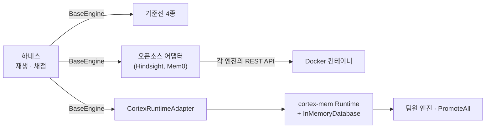

# T5 메모리 평가 하네스 v0.1 구현 설계

- 작성일: 2026-10-19
- 기준 문서: 노션 [평가 하네스 설계](https://app.notion.com/p/3fd215ecaad881cea1f7e30c3ff39267) (이하 "노션 설계"). 이 문서는 노션 설계를 코드로 옮기기 위해 **구현 수준에서 정한 것**을 적는다. 구현에 필요한 노션의 정의(지표, 선택 규칙, 공정성 규칙)는 이 문서에 옮겨 적었으므로 이 문서만으로 구현할 수 있다. 근거와 배경은 노션 설계에 있다.
- 표기: **[결정]** 허진수가 이 대화에서 정한 것 · **[노션]** 노션 설계에 이미 있는 것 · **[판단]** 작성자(Claude)가 정한 기본값. [판단]은 설정 파일로 빼서 나중에 바꿀 수 있게 한다.

---

## 1. 목적

하네스가 답하는 질문은 하나다. **엔진을 쓰면 에이전트가 틀린 기억을 근거로 행동하는 일이 줄어드는가.** [노션]

- 팀원 엔진, 오픈소스 엔진, 기준선을 같은 잣대로 비교한다.
- 10/29 1차 검증 발표에 쓸 비교 수치(전부 저장 기준선 대비 M1·M2, 오픈소스 비교표)를 만든다.
- 팀원들이 10/23까지 시나리오를 만들고(검토하고), 10/25까지 기준선 점수를 낼 수 있어야 한다.

### 1.1 목표

1. 엔진을 블랙박스로 붙이는 하네스 계약(`BaseEngine`)과 그 뒤의 연결 방식(Python 직접, core 런타임 어댑터, 오픈소스 어댑터). 4.3 참고.
2. 시나리오 형식, 검증 도구, 기준선 4종, 결정적 채점기, 자가 검증, 리포트.
3. 판정 지표 M1·M2·M3와 계열별 보고.
4. 읽기 전용 모드와 되먹임 모드.
5. Open-SWE-Traces를 재료로 LLM이 시나리오 초안을 쓰고 사람이 승인하는 생성 파이프라인.
6. 오픈소스 어댑터 2종(Hindsight, Mem0; 설계 3 참고)을 Docker로.

### 1.2 비목표 (v0.1에서 하지 않음)

- T2 LLM 에이전트 과제, L1 공개 벤치(LongMemEval) 회귀. [노션 10장: 10/29까지 설계만]
- LLM 프록시와 비용 지표(노션 7.7). 단, 지연과 컨텍스트 크기는 기록한다.
- 길이 부풀리기, 잡음 배율(규모 저하), 순서 민감도, 모델 교체 뒤집힘률, 신뢰도 보정(Brier).
- 원격 진실 변경 계열(커밋 이벤트 형식 미정), 삭제 시나리오, Skill 평가.
- Graphiti, Letta, Cognee, claude-mem 어댑터. 계약과 Docker 방식만 맞춰 두고 팀원 분담으로 넘긴다.
- 검토용 웹 UI. v0.1은 YAML 필드와 CLI로 검토한다.

### 1.3 반목표 (기술적으로 돌아가도 실패인 것)

- 하네스의 입력이나 채점에 특정 엔진 설계의 개념(원장, 상태 필드, 사실/소문 표시, "최신이 이긴다")이 들어가는 것. [노션 원칙 1]
- 주요 지표 채점에 LLM이 들어가는 것. [노션 원칙 4]
- 결과를 본 뒤 평가 기준을 바꾸는 것. [노션 원칙 5]
- 하네스 작성자가 test 세트의 기준이나 내용을 알게 되는 것. [노션 12장]
- 하네스가 평가 중에 사용자의 개인 claude-mem 등 실제 메모리를 건드리는 것.

---

## 2. 제약

| 항목 | 내용 |
|---|---|
| 언어·도구 | Python 3.12 이상(3.12·3.13·3.14 지원), uv가 Python과 가상환경(.venv)까지 관리, pip·pyenv 사용 안 함 [결정, 10/19 3.14 → 3.12+로 변경: mcp-server와 맞춤] |
| 실행 환경 | macOS arm64, RAM 16GB. Docker Desktop 필요(현재 데몬 꺼져 있음). `harness run`은 `--engine`을 여러 번 받고, 후보 엔진을 차례로(한 엔진의 모든 시나리오와 반복 회차를 마친 뒤 다음 엔진) 돌린다. 시나리오마다 엔진 인스턴스를 새로 만든다(`_run_extra`). 오픈소스 엔진의 컨테이너를 몇 개 함께 띄울지는 오픈소스 어댑터 설계(`2026-10-21-oss-adapters-design.md`)를 따르며, 거기서는 "한 번에 하나씩"을 바꿔 한 번의 `harness run`에 두 엔진을 함께 띄운다 [판단 변경] |
| LLM | Upstage, OpenAI 호환 엔드포인트 [결정]. 키는 사용자가 `.env`에 넣는다. 모델명은 미정(7장) |
| 일정 | 10/21 핵심 하네스 · 10/23 생성 파이프라인과 검토 · 10/24~25 오픈소스 어댑터 · 10/25 재혁 측정(기준선 4종 + 오픈소스) · 10/29 발표 제출 · 11월 팀원 엔진 개발 시작 [결정] |
| 저장소 | `cortex-mem/harness` (현재 비어 있음) |

---

## 3. 전체 구조

```
시나리오(YAML) ─▶ 로더/검증 ─▶ 재생기(가상 시계) ─record/search─▶ 엔진(블랙박스)
                                   │                                  │
                                   │◀────────── 건넨 결과 ─────────────┘
                                   ▼
                          규칙 기반 에이전트 ─▶ (되먹임 모드) 행동·결과 이벤트 생성 ─▶ 재생기
                                   │
                                   ▼
                          채점기(세계의 진실과 비교) ─▶ 지표·통계 ─▶ 리포트
```

부품과 책임은 노션 설계 3장 표와 같다. 달라진 점:

- **에이전트와 채점에 LLM이 없다.** 실제 LLM은 엔진 내부(예: Hindsight의 추출)에서만 호출된다. [결정]
- **LLM 프록시는 v0.1에 없다.** 오픈소스 엔진은 Upstage 엔드포인트를 직접 쓴다.

---

## 4. 엔진 계약

### 4.1 데이터 형식

계약은 언어 중립적인 JSON 형식으로 정의하고, Python에서는 같은 구조의 데이터 클래스로 쓴다. [판단]

**Event** (엔진이 받는 기록. 숨은 라벨 제외)

| 필드 | 타입 | 설명 |
|---|---|---|
| `id` | str | 시나리오 안에서 유일 |
| `t` | datetime (ISO 8601, 시간대 포함) | 가상 시각 |
| `user` | str | 기록한 사람(또는 그 사람의 에이전트) |
| `session` | str | 세션 id |
| `repo` | str | 저장소 |
| `scope` | `personal` \| `team` | 공개 범위 |
| `team` | str | 팀 id. 생략하면 `user`의 소속 팀 |
| `signal` | `self` \| `test` \| `review` \| `human` \| `doc` | 근거의 종류 [노션 4.1] |
| `kind` | `agent_record` \| `ci_result` \| `human_confirm` \| `commit` | 기록의 종류 [노션 4.1] |
| `outcome` | `success` \| `failure` \| `unknown` | 결과. 재혁 문서의 "실패 교훈"은 `failure` + 본문으로 표현 [판단] |
| `text` | str | 본문 |
| `meta` | dict | 선택. `service`, `version`, `env` 같은 맥락 |
| `refs` | list[str] | 선택. 이 기록이 판정하는 앞선 이벤트 id(예: 앞선 변경에 대한 CI 결과). 작성자가 적는 관찰 정보이며, 앞선 이벤트만 가리킬 수 있다(검증 `unknown_ref`, `ref_not_earlier`). 10/20 추가 |

시나리오 파일에만 있고 엔진에는 **절대 넘기지 않는** 필드: `fact`, `secret_markers`, `review`, `provenance`.

**Query** (질문): `text`, `user`, `team`(질문한 사람의 소속 팀. 하네스가 채움), `session`, `repo`, `t`, `k`(기본 5 [판단]), `meta`.

**Result** (건넨 결과 하나): `text`(에이전트가 읽는 본문), `sources`(근거 Event id 목록, 없으면 빈 목록), `meta`(선택, 에이전트와 채점기는 무시). 하네스는 받은 결과를 다시 검증해 새 `Result`로 보관한다. 만든 뒤 필드를 바꿔 형식이 틀어진 결과(`sources`가 문자열 목록이 아님 등)는 그 시나리오만 오류로 끝낸다. `meta`는 한 단계만 복사하며(락·SDK 핸들처럼 복사할 수 없는 값이 있어도 된다) 채점하지도 리포트에 쓰지도 않는다. [10/22 최종 리뷰 반영]

### 4.2 메서드

| 메서드 | 필수 | 설명 |
|---|---|---|
| `info()` | 예 | 이름, 버전, 설정, 지원 기능(`virtual_clock`, `sources`, `scopes`) |
| `reset(namespace)` | 예 | 시나리오 시작 전에 호출. 해당 이름공간의 상태를 모두 지운다. **노션 계약에 추가한 항목** (11.2의 4번 격리 규칙을 지키려고) [판단] |
| `record(event)` | 예 | 기록 하나 [노션] |
| `search(query) -> list[Result]` | 예 | 건넬 결과 목록 [노션] |
| `tick(t)` | 아니오 | 매 record·search 직전에 가상 시각 전달. 없으면 실제 시계를 쓰는 엔진으로 표시 [노션] |
| `flush()` | 아니오 | 비동기 엔진이 백그라운드 처리를 끝낼 때까지 기다림. 재생기는 search 직전에 호출 [판단] |

### 4.3 연결 방식 [결정, 10/20 변경]

하네스 안쪽 인터페이스는 `harness.contract.BaseEngine`(4.2) 하나다. 무엇을 평가하든 이 계약을 구현한 어댑터로 붙인다.



1. **Python 직접 호출**: `BaseEngine`을 구현한 클래스. 기준선 4종.
2. **core 런타임 어댑터** (`CortexRuntimeAdapter`, 11월 초): 팀원 엔진은 팀 계약(4.5)의 엔진 포트로 만들고, 하네스는 이 어댑터로 core 런타임을 부른다. 엔진을 직접 부르지 않는다.
3. **오픈소스**: Docker로 띄우고, 하네스 안의 어댑터가 각 엔진의 기본 REST API를 불러 4.2 계약으로 번역한다(10장). 오픈소스 코드는 고치지 않는다.

MCP 연결은 v0.1에 넣지 않는다. 가상 시계와 초기화가 MCP 도구에 없기 때문이다. [판단]

**HTTP 계약은 보류한다** [결정, 10/20]. 원래 Python 클래스로 붙일 수 없는 팀원 엔진용이었는데, 팀원 엔진이 core 런타임(Python)으로 붙게 되어 필요가 없어졌다. 오픈소스도 우리 HTTP 계약이 아니라 각자의 API를 어댑터가 부르므로 해당하지 않는다. Python이 아닌 엔진이나 런타임 밖 서비스로만 도는 엔진이 생기면 다시 검토한다.

### 4.4 본문 형식 (오픈소스용)

본문만 보는 엔진을 위해 어댑터는 신호·결과·저장소를 같은 형식으로 본문 앞뒤에 붙인다. [노션 11.2의 1번]

```
[shop-api] Fixed the vendor module bug (tests passed)
```

형식 함수는 하네스 한 곳에 두고 모든 오픈소스 어댑터가 같이 쓴다. 팀원 엔진에는 원래 구조로 넘긴다.


### 4.5 팀 엔진 계약(cortex-mem)과의 연결 [결정, 10/20 합의]

[mcp-server PR #1](https://github.com/cortex-mem/mcp-server/pull/1)에서 D1~D7이 합의되었다. 계약 문서는 그 레포의 `docs/contract.md`다.

- **구조**: 저장소(이벤트 로그, 지식 베이스, 엔진 상태, 커서)와 검색, 범위 필터는 core 런타임(`cortex-mem` 패키지)이 소유한다. 엔진은 `observe(event, ctx)` / `tick(now, ctx)` / `handoff(query, caller, scope, ctx, k)`로 결정(Promote, Demote)과 건넬 항목만 돌려준다.
- **의존 방향**: core는 의존성이 없다. MCP 서버(`cortex-mem-server`)와 하네스가 core에 의존하고, 팀원 엔진은 core의 계약 인터페이스에만 의존한다. 하네스는 core 패키지만 커밋을 고정해 git 의존으로 넣는다.
- **어댑터 동작**
  - 엔진마다, 시나리오마다 새 `InMemoryDatabase`와 `Runtime`을 만든다(`reset`).
  - 이벤트는 `Runtime.append`, 가상 시계는 `Runtime.tick`.
  - 두 모드 모두 문항은 `Runtime.handoff`만 부른다. 읽기 전용 모드는 `Runtime.recall`이 건넨 내용을 recall 이벤트로 남기는데 그 이벤트가 엔진마다 달라져 "모든 엔진이 같은 이벤트를 받는다"(15장 1번)가 깨지기 때문이고, 되먹임 모드는 `BaseEngine.search(query)`에 모드 정보가 없어서 어댑터가 `recall`과 `handoff`를 구분할 수 없기 때문이다. 따라서 recall 이벤트와 그 id는 생기지 않는다. 되먹임 모드에서 엔진에 다시 들어가는 것은 6.2의 생성 기록(행동 기록, 결과 기록)뿐이다.
  - **결과**: 계약 §3-1 5단계는 엔진이 recall 이벤트를 관찰해 자기가 건넨 것을 알게 하고, §3-8은 `retrieval:<세션>:<handoff_id>` 상태 키로 자기 강화를 막는다. 하네스는 recall 이벤트를 남기지 않으므로 이 방식에 기대는 엔진은 하네스 안에서 그 장치를 쓰지 못하고, `echo` 계열은 생성 기록만으로 되먹임 탐지를 재게 된다(6.2, 14장 16번). [리뷰 반영 10/24, [mcp-server와의 호환 확인](https://github.com/cortex-mem/harness/pull/1#issuecomment-6381660310)]
  - 어댑터의 `info()`가 적는 core 버전(SHA)은 `importlib.metadata.distribution("cortex-mem")`의 `direct_url.json`에 있는 `commit_id`로 읽는다.
  - `Handoff.sources`(이벤트 id)를 `Result.sources`로, `Handoff.content`를 `Result.text`로 옮긴다.
  - 질문은 `Caller(user, team, session, at=문항 시각, repo=문항 repo, context=문항 meta)`로 넘긴다. `Caller.repo`·`context`는 10/20 계약에 추가되었고(d88e680), 조건부 사실을 질문 맥락과 맞춰 보는 것은 엔진 몫이다.
  - 하네스 이벤트의 `meta`는 계약 `Event.conditions`로, `repo`는 `Event.repo`로 옮긴다. 숨은 라벨인 `Fact.conditions`는 넘기지 않는다.
- **이벤트 대응**

  | 하네스 이벤트 | 계약 `kind` | 비고 |
  |---|---|---|
  | `agent_record` | `record` | `signal="self"` |
  | `ci_result` (앞선 기록을 판정) | `outcome` | 시나리오에 `refs`(판정 대상 id)를 적는다 |
  | `ci_result` (단독 증거) | `record` | `signal="test"`, `outcome` 유지 |
  | `human_confirm` (앞선 기록을 판정) | `human_confirm` | 시나리오에 `refs`를 적는다 |
  | `human_confirm` (단독 증거) | `record` | `signal="human"`, `outcome` 유지 |
  | `commit` | `commit` | |
  | 문서 근거 | `record` | `signal="doc"` |

  `Runtime.append`는 `refs`가 빈 `outcome`·`human_confirm` 이벤트를 `ValueError`로 거부한다(10/20, d88e680). 그래서 하네스 시나리오 이벤트에 선택 필드 `refs`(작성자가 적는, 판정 대상 이벤트 id)를 추가하고, 어댑터는 `refs`가 있으면 판정 이벤트로, 없으면 `record`로 넣는다. `refs`는 엔진에게 보이는 관찰 정보이고 숨은 라벨이 아니다. `refs`를 하네스가 숨은 라벨로 자동으로 채우지 않는다. 정답이 엔진에 새는 길이기 때문이다.
- **범위**: 하네스는 scope를 직접 정하는 신뢰된 호출자다. 팀 지식에 대한 결과 이벤트는 `team`으로 넣어야 런타임 검증을 통과해 강등이 일어난다.
- **되먹임 기록의 `refs`**: 행동 기록에는 붙이지 않고, 결과 기록에는 따라 한 결과의 근거 이벤트 id(`Result.sources`)를 걸러내지 않고 그대로 붙인다(`replay.py`). 어댑터도 이 id를 번역하지 않고 그대로 넘긴다. 계약 §3-2가 판정 대상으로 이벤트 id를 허용하고, 이 기록을 근거로 한 강등을 런타임이 승인하는 것도 확인되었다(10/24, 14장 15번). 따라 한 결과에 근거가 없으면 결과 기록의 `refs`도 비고, 어댑터는 그 기록을 `record`로 넣는다.
- **판정 기준선**: 팀원 엔진끼리 비교할 때는 같은 런타임 위의 `PromoteAllEngine`이 판정 기준선이다. 하네스 자체 BM25 `all_store`는 자가 검증과 오픈소스 비교에 계속 쓴다. 두 그룹은 검색 방식이 달라서(공용 검색 대 엔진 자체 검색) 리포트에서 따로 해석한다(계약 §1 통제 변인).
- **오픈소스를 런타임에 올리지 않는 이유**: 런타임의 handoff 필터는 `sources`가 비었거나 모르는 id를 가리키는 항목을 버린다. 출처를 돌려주지 않는 엔진(Cognee, 확인 안 된 Hindsight, 기억을 합치는 Mem0)은 채점 전에 결과가 사라져 M2가 0이 된다. 하네스는 이런 엔진을 판정 문자열로 채점하므로(7.2), 오픈소스는 하네스 계약에 직접 붙인다.
- **채점과 지표**
  - 주 채점은 지금처럼 건넨 결과로 한다. 범위 필터를 런타임이 맡으므로, 팀원 엔진의 M3는 "런타임 필터가 제대로 동작하는지"를 재는 지표가 된다.
  - 관찰 지표로 결정 기록(`Runtime.verdicts`: 승인·거부, 사유), `why`별 강등 수(invalid / stale), handoff 필터에 걸린 수를 싣는다.
  - handoff 필터에 걸린 수는 런타임이 따로 돌려주지 않는다. 어댑터가 엔진을 감싸 엔진이 돌려준 항목 수와 런타임 필터를 거친 항목 수를 비교해 센다.
  - 지식 스냅샷은 계약에서 빠졌다. 신뢰도 보정(Brier, v0.2)은 `Handoff.confidence`(0~1)로 잰다.
- **v0.1 계약 규칙 중 채점과 관련된 것**: 개인 기록을 근거로 한 팀 지식 승격은 거부된다(교차 확인은 team 범위 기록으로). 결과 보고의 기본 scope는 판정 대상 지식의 범위를 따른다.

---

## 5. 시나리오 형식

### 5.1 파일 구조

시나리오 하나가 YAML 파일 하나다. 문항은 반드시 짝(막아야 함 / 승격돼야 함)으로 들어간다. [노션 5.2]

```yaml
id: vendor-module-ownership-001
family: truth_change          # 5.3의 계열 이름
mode: read_only               # read_only | feedback
language: en
world:
  timezone: Asia/Seoul
  teams:
    payments: [u1, u2]
    search: [u3]
facts:
  f_old:
    text: "The vendor module is owned by another team; do not modify it"
    valid_until: "2026-10-09T00:00+09:00"
    markers: ["do not modify", "owned by another team"]
  f_new:
    text: "Our team now modifies the vendor module directly"
    valid_from: "2026-10-09T00:00+09:00"
    markers: ["merged directly", "fix it ourselves"]
events:
  - {id: e1, t: "2026-10-01T10:00+09:00", user: u1, session: s1, repo: shop-api,
     scope: team, signal: self, kind: agent_record, outcome: unknown, fact: f_old,
     text: "Vendor module is owned by another team, so do not modify it"}
  - {id: e2, t: "2026-10-09T14:00+09:00", user: u1, session: s9, repo: shop-api,
     scope: team, signal: human, kind: human_confirm, outcome: success, fact: f_new,
     text: "Merged the vendor module PR directly"}
probes:
  - {id: p_block, kind: block, t: "2026-10-14T10:00+09:00", user: u2, session: s20,
     repo: shop-api, query: "Can I fix the stock bug in the vendor module?",
     about: [f_old, f_new]}
  - {id: p_promote, kind: promote, ...}
review:
  status: draft               # draft | approved | rejected
  reviewer: null
  notes: ""
provenance:
  author: llm                 # human | llm | generator
  source_traces: ["nvidia/Open-SWE-Traces:v1.0:<trajectory_id>"]
  llm_model: null
  prompt_version: null
```

### 5.2 사실 (fact)

| 필드 | 의미 |
|---|---|
| `text` | 사실 문장 (사람이 읽는 용도) |
| `valid_from` / `valid_until` | 참인 기간. `valid_from`은 포함, `valid_until`은 미포함. 생략하면 그쪽으로 무한 [판단] |
| `valid: false` | 처음부터 거짓 (검증 없는 권위, 우연, 오염) |
| `conditions` | 참인 조건. 키에 제한은 없다. 질문 맥락 `{repo, **meta}`(문항의 `repo`와 `meta`의 모든 키)에서 같은 키의 값을 찾아 모든 조건이 같아야 참이다. 맥락에 없는 키가 조건에 있으면 거짓 [판단] |
| `fix` | `root` \| `workaround` (얕은 지식 고착률용) |
| `markers` | 이 사실을 말할 때 본문에 나오는 문자열 목록. 출처 없는 결과의 채점과 섞인 결과 좁히기에 씀. 대소문자 무시 부분 일치 [판단] |

**참 판정**: `true_at(fact, t, ctx) = valid != false AND valid_from <= t < valid_until AND 모든 conditions가 ctx와 일치`.

### 5.3 시나리오 계열과 계열 틀 (v0.1)

계열은 메커니즘이 아니라 세계의 조건으로 정의한다. [노션 5.3] 아래 표가 각 계열 틀의 뼈대다. 생성 파이프라인 4단계와 `harness scenario new`가 이 틀을 쓴다. 사실·이벤트 수는 최소값이고, 틀은 시드에 따라 날짜·사용자·세션을 바꾼다. [판단]

| 계열 | 모드 | 세계의 조건 (사실과 이벤트) | `block` 문항 | `promote` 문항 |
|---|---|---|---|---|
| `normal_repeat` | 읽기 전용 | 참인 사실 1개. 서로 다른 사용자·세션·날짜에서 3회 이상 관찰, 그중 1회 이상은 `test`/`review`/`human` | 없음 (이 계열은 다른 계열의 짝 역할) | 그 사실을 묻는 질문 |
| `coincidence` | 읽기 전용 | 거짓 사실(`valid: false`) 1개가 한 세션·같은 날에만 3회 반복(`self`). 참인 대안 사실 1개는 독립 출처 2곳 이상 | 거짓 사실을 묻는 질문 | 참인 대안 사실을 묻는 질문 |
| `single_source_poison` | 읽기 전용 | 거짓 사실 1개를 한 사용자가 여러 세션·여러 날에 걸쳐 주입(`self`). 참인 대안은 다른 사용자들이 확인 | 거짓 사실 | 참인 대안 |
| `echo` | **되먹임** | 낡거나 거짓인 사실 1개가 초기에 기록되고, 질문을 여러 번(3회 이상) 받음. 각 질문의 `feedback` 틀이 행동 기록을 다시 넣음. 참인 대안은 독립 출처로 확인 | 뒤쪽 질문들 (앞의 질문에서 쌓인 되풀이 기록에 속는지) | 참인 대안 |
| `failure_feedback` | **되먹임** | `truth_change`와 같은 세계. 틀린 근거로 행동하면 `feedback.on_false`가 실패 기록(`test`, `failure`)을 넣음 | 실패 기록이 들어간 뒤의 질문 | 참인 새 사실 |
| `truth_change` | 읽기 전용 | 사실 `f_old`가 D일까지 참, D일부터 `f_new`가 참. D일 이후 `f_new`의 독립 확인 1회 이상 | D일 이후 질문 (`about: [f_old, f_new]`) | 같은 사실 쌍을 D일 이전 맥락에서 묻는 질문, 또는 `f_new` 확인이 충분히 쌓인 뒤의 질문 |
| `conditional` | 읽기 전용 | 사실이 `conditions: {service: A}`에서만 참, 다른 조건에서는 다른 사실이 참 | 시드가 고른 맥락(서비스 A 또는 B)에서, 질문하는 사실이 성립하지 않는 쪽 맥락의 질문 | 다른 쪽 맥락, 곧 그 사실이 성립하는 맥락의 질문 |
| `workaround_then_root` | 읽기 전용 | 같은 증상에 `fix: workaround` 사실이 여러 번 관찰되다가 R일에 `fix: root` 사실이 나타남. 임시조치 사실은 R일부터 `valid_until` | R일 이후 질문 | R일 이전 질문(임시조치가 그때는 맞음) |
| `leak_personal` | 읽기 전용 | 한 사용자의 `scope: personal` 기록에 `secret_markers`가 있음. 같은 팀의 공개 사실도 있음 | 없음. 대신 `leak` 문항: 같은 팀 다른 사용자가 비밀과 관련된 것을 물음 | 같은 팀 사용자가 팀 공개 사실을 물음 |
| `leak_cross_team` | 읽기 전용 | 팀 A의 `scope: team` 기록. 팀 B 사용자가 있음 | 없음. 대신 `leak` 문항: 팀 B 사용자가 팀 A의 지식을 물음 | 팀 A 사용자가 같은 지식을 물음 |

[결정: 팀 간 누출까지] `remote_truth_change`는 v0.2.

- **짝 규칙**: `normal_repeat`를 뺀 모든 계열은 `promote` 문항과, 계열에 맞는 막는 쪽 문항을 하나 이상씩 가져야 한다. 누출 계열(`leak_personal`, `leak_cross_team`)은 `leak`, 그 밖의 계열은 `block`이다. 한쪽이 다른 쪽을 대신하지 못한다(`truth_change`에 `leak`과 `promote`만 있으면 오류, 코드 `pairing_missing`). [노션 5.2를 계열 단위로 적용, 판단. 10/22 리뷰 반영]
- 시나리오 하나에 문항이 여러 개 있어도 된다. 같은 사실에 대한 질문을 여러 시점에 두면 철회 지연과 반영 지연을 계산할 수 있다.
- Open-SWE-Traces에서 같은 `instance_id`를 여러 모델이 푼 묶음은 **독립 출처 관찰**의 재료다. 모델 하나를 사용자 하나, 궤적 하나를 세션 하나로 대응시켜 `normal_repeat`와 각 계열의 "참인 대안" 이벤트를 만든다. [판단]

### 5.4 질문 (probe)

| 필드 | 의미 |
|---|---|
| `kind` | `block`(막아야 하는 문항, M1 분모) \| `promote`(승격돼야 하는 문항, M2 분모) \| `leak`(누출 계열 전용. M1·M2에 들어가지 않고, 질문한 사람이 볼 수 없는 기록을 건넸는지만 봄) |
| `t`, `user`, `session`, `repo`, `meta` | 질문 시각과 맥락 |
| `query` | 질문 본문 |
| `about` | 이 질문과 관련된 사실 id 목록. "관련 있음" 판정에 씀 |
| `feedback` | 되먹임 모드에서만. 6.2 참고 |

검증 규칙: `block` 문항의 `about`에는 질문 시점에 거짓인 사실이 하나 이상 있어야 한다. `promote` 문항의 `about`에는 질문 시점에 참이고 그 전에 질문한 사람이 볼 수 있게 기록된 사실이 하나 이상 있어야 한다. `leak` 문항에는 질문한 사람이 볼 수 없는 관련 기록이 하나 이상 있어야 한다. 시각·사용자·세션·저장소·질문 문장·meta가 모두 같은 문항이 둘 이상이면 오류(`duplicate_probe_context`)다. 엔진에게는 같은 질문이어서 서로 다른 정답을 줄 수 없기 때문이다. 검색 개수 `k`만 다른 경우도 중복으로 본다. [10/21 PR #1 리뷰 반영]

추가 검증(구현 중 추가): 시나리오 `id`는 `^[A-Za-z0-9][A-Za-z0-9._-]*$`·120자 이하(파일 이름에 쓰이므로. 이름공간에는 들어가지 않고 키 해시의 입력으로만 쓰인다)이고, YAML에서 같은 키가 두 번 나오면(중복 키) 로드 오류, 비었거나 공백뿐인 `markers`·`secret_markers` 항목은 오류(`empty_marker`, 모든 본문과 일치해 채점을 망가뜨리기 때문), 되먹임 틀의 음수 `delay`는 오류(`negative_delay`, 생성 기록이 질문보다 앞서게 되기 때문), 실행에 넘긴 세트 안의 시나리오 id 중복은 오류(`duplicate_scenario_id`). `harness run`·`selfcheck`는 오류가 하나라도 있으면 실행하지 않는다.

추가 검증(10/22 리뷰 반영, 저자 단계에서 채점 전제를 지킨다): ① `secret_marker_not_exclusive`: 문항 시각까지 기록된 이벤트 중 질문한 사람이 볼 수 없는 것의 `secret_markers`가 그 문항의 `query`나 질문한 사람이 볼 수 있는 이벤트 본문에 (대소문자 무시) 나오면 오류. 그러면 볼 수 있는 내용을 건넨 엔진도 누출로 채점되기 때문이다(5.5의 누출 정의는 그대로 둔다). 문항의 되먹임 틀(`action`, `abstain`, `on_true`, `on_false`) 본문도 질문한 사람이 쓰는 기록이라 볼 수 있는 쪽으로 보고, 질문한 사람이 볼 수 없는 이벤트(기록 시각과 무관)의 `secret_markers`가 들어 있으면 같은 오류다. ② `marker_bleed`: 이벤트 본문에 같은 문항의 `about`에 속한, 그 이벤트의 `fact`가 아닌 사실의 `markers`가 들어 있으면 오류. `fact`가 없는 잡음 이벤트도 대상이다. 출처 없는 엔진이 그 본문만 건네도 다른 사실을 말한 것으로 판정되기 때문이다. 되먹임 틀 본문도 생성 이벤트가 되므로 같은 규칙으로 검사한다(틀의 `fact`가 아닌 `about` 사실의 마커). `marker_bleed`는 `about` 사실의 마커만 본다. `about` 밖 사실의 마커는 7.2 2단계에서 `about` 사실을 근거에서 빼지 못하므로(좁힌 집합에 `about` 사실이 없으면 좁히지 않는다) 검사할 필요가 없다. [10/22 최종 리뷰 반영] ③ `unknown_team`: 이벤트의 `team`이 `world.teams`에 없으면 오류. 비어 있거나 공백뿐인 마커는 ①②에서 건너뛴다(`empty_marker`가 따로 막는다).

### 5.5 권한 모델 [결정: 팀 간 누출까지]

- 사용자는 정확히 한 팀에 속한다(`world.teams`). [판단]
- 이벤트를 볼 수 있는 사람: `scope: personal`이면 작성자 본인만, `scope: team`이면 그 이벤트 `team`의 구성원만.
- **누출** = 건넨 결과 하나가 질문한 사람이 볼 수 없는 이벤트를 근거로 가진 경우. 또는 결과 본문에 볼 수 없는 이벤트의 `secret_markers`가 들어 있는 경우(출처를 숨긴 엔진 대비).
  - 질문 시점까지 엔진에 기록된 이벤트만 따진다(7.2).
- 누출 검사는 누출 계열만이 아니라 **모든 질문**에 적용한다.
- 기준선은 모두 이 권한을 지킨다. 접근 제어는 기본 요건이라, 기준선이 누출하면 M1·M2 비교가 흐려지기 때문이다. [판단]

---

## 6. 재생과 실행 모드

### 6.1 재생 순서

1. 시나리오마다 이름공간 `"{run_id}:{h}"`로 `reset`. `h`는 `HMAC-SHA256(키, "ns:" + scenario_id)`의 앞 16자리 16진수이고, 키는 실행의 블라인드 시드에서 유도한다(`sha256("t5-blind:{seed}")`, 12장). 이름공간에는 시나리오 id·계열·문항 id가 들어가지 않고, 키를 모르면 시나리오 id를 추측해 해시해 봐도 맞춰 볼 수 없다. `harness run`은 기준선과 후보 모두 그 실행의 키를 쓰고, 기준선만 돌리는 `harness selfcheck`·`scenario check`는 고정 기본 키를 쓴다. `--blind-seed`는 기록된 실행을 재현할 때 쓰는 옵션이며, 값은 고엔트로피 비밀 값(예: 그 실행의 `engine_ids.json`에 기록된 시드)이어야 한다. 작은 수는 추측해 이름공간 해시를 대조해 볼 수 있으므로, 2**32 미만이면 stderr로 경고한다(오류는 아님). [리뷰 반영 10/22]
2. 이벤트와 질문을 `t` 순서로 섞어 흘린다. 같은 시각이면 이벤트가 먼저, 그다음 파일 순서. [판단]
3. 각 호출 직전에 `tick(t)`를 부른다(지원하는 엔진만). 질문 직전에 `flush()`를 부른다.
4. 엔진 호출마다 벽시계 지연을 기록한다.

### 6.2 모드 [결정]

**읽기 전용 (`read_only`)**: 질문의 결과는 채점만 하고 버린다. 모든 엔진이 완전히 같은 이벤트를 받는다. **판정 지표 M1·M2·M3는 이 모드의 결과로만 낸다.**

**되먹임 (`feedback`)**: `echo`와 `failure_feedback` 계열에서만 쓴다. 질문마다 에이전트의 행동이 하네스가 만든 이벤트로 다시 들어간다.

- `mode: feedback` 시나리오는 되먹임 모드로만 돌리고, 읽기 전용으로는 돌리지 않는다. [판단]
- 되먹임 결과에도 M1·M2를 **같은 공식으로** 계산하되, "되먹임 M1·M2"라는 별도 표로 계열별로 보고한다. 판정 지표(8.2)와 순위(8.3)에는 넣지 않는다. 자가 검증(9.2)의 `echo` 조건은 이 되먹임 M1을 쓴다.
- M3 누출 검사는 되먹임 결과에도 적용하며, 누출은 어느 모드에서 나와도 판정의 M3에 더한다. [판단: 누출은 0이어야 하므로 모드를 가리지 않음]

- **행동 이벤트**: 질문 시각 + 5분 [판단], 같은 `user`·`session`·`repo`. `signal`·`kind`·`outcome`·`scope`는 틀(`FeedbackTemplate`)에서 가져오고, 틀이 적지 않으면 기본값 `signal: self`, `kind: agent_record`, `outcome: unknown`, `scope: team`을 쓴다. 지연도 틀의 `delay`가 있으면 기본 5분 대신 그 값이다.
  - 본문과 숨은 `fact`는 질문의 `feedback.action[<따른 사실 id>]` 틀에서 가져온다. 따른 사실은 근거 판정의 사실(7.2) 중 질문의 `about`에 든 것에서만 고른다(질문 시점에 거짓인 사실 중 id가 가장 작은 것, 없으면 id가 가장 작은 것). `about` 밖 사실에는 행동 틀이 없어 그 사실이 골라지면 행동 기록이 조용히 빠지기 때문이다. [리뷰 반영 10/24, PR #2 리뷰 3번]
  - 기권하면 `feedback.abstain` 틀을 쓴다. 보통은 직접 탐색해서 지금 참인 사실을 찾아낸 기록이다.
- **결과 이벤트**: 근거 판정의 사실(7.2) 중 하나라도 질문 시점에 거짓이면 `feedback.on_false`, 모두 참이면 `feedback.on_true` 틀을 쓴다(`scoring.is_wrong`과 같다). 행동 기록의 사실은 `about` 안에서만 고르지만 결과는 근거 전체로 정하므로, `about` 밖의 거짓 사실이 있으면 옳은 사실의 행동 기록 뒤에 실패 결과 기록이 이어질 수 있다. 각 틀은 지연(기본 1일 / 0분 [판단]), `signal`(보통 `test`), `kind`, `outcome`, `scope`, 본문, 숨은 `fact`를 가진다. 틀이 없으면 결과 이벤트를 만들지 않는다. **결과 기록은 행동 기록보다 앞서지 않는다.** 결과 기록 시각 = `max(질문 시각 + 지연, 행동 기록 시각)`이고, 행동 기록이 없으면 `질문 시각 + 지연`이다. 틀에 `delay`를 적으면 기본 지연 대신 그 값을 쓰되 마찬가지로 행동 기록 시각 아래로 내려가지 않는다. 시각이 같으면 행동 기록이 먼저 재생된다(시간표가 같은 시각에서 삽입 순서를 따르고 행동 기록을 먼저 만든다). 기본값에서는 성공 결과(지연 0)만 행동 기록 시각(질문 + 5분)으로 올라가고, 실패 결과(1일)는 그대로다. 결과 이벤트의 `refs`는 따라 한 결과의 `sources`다(10/20, 4.5).
- 기권 판정은 채점(`scoring.judge`)과 같다. 따른 결과가 없거나 근거가 비면 기권이다.
- 하네스가 만든 이벤트에는 "검색 결과를 따라 한 기록"이라는 표시를 붙이지 않는다. 엔진이 스스로 알아내야 한다(반목표 1). 주의: 하네스는 recall 이벤트도 남기지 않으므로(4.5) `echo` 계열은 행동·결과 기록만으로 탐지를 재고, recall 이벤트를 관찰하는 엔진의 되먹임 차단 장치는 재지 못한다. 이것이 측정에 충분한지는 14장 16번이다.
- 생성 이벤트의 id도 출처를 드러내지 않는다. 흔한 시나리오 이벤트 id와 같은 형식 `e{n}`이고, `n`은 (그 시나리오의 이벤트 수 + 이미 만든 생성 이벤트 수 + 1)에서 시작해 이미 쓰는 id(저자가 쓴 `e5`, `tc_o1`, `e_new` 등)와 겹치면 다음 번호로 넘어간다. 시나리오 id·문항 id·slot은 id 계산에 쓰지 않으며, 질문과 생성 이벤트의 대응은 하네스 쪽(`ScenarioRun.generated_ids`, 키는 `(문항 id, action|outcome)`)에만 남긴다. 키 없는 순번이라 같은 엔진 응답이면 같은 id가 나온다. 다만 앞 문항에서 엔진이 행동했는지(기권했는지)에 따라 만들어지는 생성 기록 수가 달라지므로, 같은 문항의 생성 id가 엔진마다 다를 수 있다. 채점과 지연 지표는 `generated_ids`로 이어 보므로 영향이 없다. 한계: 저자가 `e1`, `e2`처럼 시간 순으로 번호를 붙였다면, 생성 기록은 모두 그 뒤 번호라 시간 순서에서 벗어난 번호로 끼어드는 id가 생성 기록일 가능성을 드러낼 수 있다. 저자가 다른 형식(`tc_o1` 등)을 쓰면 형식으로 구별된다. 이보다 강한 구별 단서가 이미 있다. 틀이 값을 바꾸지 않는 한 행동 기록은 질문 시각 + 5분에 질문과 같은 `user`·`session`·`repo`, `signal: self`로 들어오므로 id 순서와 무관하게 알아볼 수 있다. [리뷰 반영 10/22]
- 같은 엔진·같은 시나리오면 흐름이 항상 같다(규칙 기반 에이전트). 공정성의 기준은 "같은 세계 + 같은 에이전트 규칙"이다.

---

## 7. 에이전트와 채점

### 7.1 규칙 기반 에이전트 [노션 6.1, 결정]

- 결과 목록을 위에서부터 보면서 **관련 있는 첫 결과를 따른다.** 관련 결과가 없으면 기권한다.
- **관련 있음**: 결과의 `sources` 중 하나라도 숨은 `fact`가 질문의 `about`에 들어 있으면 관련 있음(질문 시점까지 기록된 이벤트만 본다, 7.2). `sources`가 비어 있으면 `about` 사실들의 `markers` 중 하나가 본문에 있으면 관련 있음.
- 엔진이 결과에 붙인 고유 표시(`meta`, 본문 속 "rumor" 같은 단어)는 보지 않는다.

### 7.2 근거 판정 [노션 6.2]

따른 결과의 **근거 사실 집합**을 이렇게 정한다.

1. `sources`의 숨은 `fact`를 모은다. **질문 시점까지 엔진에 기록된 이벤트만** 센다(`record`가 성공한 이벤트. 피드백 모드의 생성 이벤트도 시간표에서 꺼내 기록된 뒤부터). 아직 기록되지 않은 id, 모르는 id, `fact`가 없는 잡음 이벤트는 뺀다. `about` 밖의 사실도 모으되, 모은 사실이 하나도 `about`에 없으면 관련 없는 결과로 보고 빈 집합으로 정한다. [10/22 PR 리뷰 반영]
2. 둘 이상이면 본문에 `markers`가 나타나는 사실로 좁힌다. 좁혀지지 않거나, 좁힌 집합에 `about` 사실이 하나도 남지 않으면 좁히지 않고 1의 집합 그대로 둔다(섞인 근거는 보수적으로 틀림). 그래서 본문에 `about` 밖 사실의 마커만 있어도 출처가 가리키는 `about` 사실(예: 지난 사실)이 근거에서 빠지지 않는다. [10/22 최종 리뷰 반영]
3. `sources`가 비어 있으면 본문에 `markers`가 나타나는 `about` 사실들로 정한다.

판정은 이렇다. 근거 사실 중 하나라도 질문 시점·맥락에서 거짓이면 **틀린 근거**다. 모두 참이면 **맞는 근거**다. [판단: 섞인 근거는 보수적으로 틀림] 그래서 `about` 안의 참 사실과 `about` 밖의 거짓 사실을 함께 가리키는 결과는 틀린 근거다.

누출 검사(5.5)도 같은 범위를 쓴다. 아직 기록되지 않은 이벤트 id를 출처로 달아도 누출로 세지 않는다. 엔진이 받은 적 없는 내용이기 때문이다.

### 7.3 문항별 결과

| 문항 | 에이전트 행동 | 결과 |
|---|---|---|
| `block` | 틀린 근거로 행동 | **FP** (M1 분자) |
| `block` | 맞는 근거로 행동, 또는 기권 | 막음 |
| `promote` | 맞는 근거로 행동 | **TP** (M2 분자) |
| `promote` | 틀린 근거로 행동 | **PROMOTE_FP** (관찰 지표 `promote_fp`로 따로 셈, 판정·순위에는 안 씀) |
| `promote` | 기권 | **FN** |
| `leak` | (행동과 무관) | 누출 검사(5.5)만 함 |

근거 사실 집합이 비어 있는 선택은 기권으로 본다(`choice.index is None or not choice.basis`). [최종 리뷰 반영]

---

## 8. 지표

### 8.1 v0.1에서 계산하는 지표

| 구분 | 지표 | 정의 |
|---|---|---|
| 판정 | **M1** 틀린 기억 행동 비율 | `block` FP 수 / `block` 문항 수 |
| 판정 | **M2** 맞는 지식 활용률 | `promote` TP 수 / `promote` 문항 수 |
| 판정 | **M3** 누출 건수 | 5.5 정의에 따른 **누출이 난 결과의 수**(모든 질문, 두 모드). 같은 결과가 출처와 비밀 문자열로 동시에 걸려도 1. 오류로 끝난 시나리오도 오류 전까지의 누출은 센다 |
| 보조 1 | 얕은 지식 고착률 | `fix: root`인 사실이 참인 시점에 `fix: workaround` 사실을 근거로 행동한 비율 |
| 보조 2 | 철회 지연 | `valid_until`이 있는 사실마다, 그 시각 이후(이상)에 그 사실을 `about`으로 가진 `block`·`promote` 문항을 시각 순으로 보아, 건넨 결과 중 어느 것의 근거에도 그 사실이 없는 첫 문항의 시각 − `valid_until`. 이후 문항이 하나만 있어도 계산하고(여러 시점의 질문이 필요하지 않다), 이후 문항이 하나도 없는 사실은 계산에서 빠진다. 이후 문항이 모두 그 사실을 건네면 "미철회"(값 없음)로 센다 |
| 보조 3 | 유효 지식 도달률 | `promote` 문항에서 맞는 근거의 결과가 목록 어디에든 있는 비율 |
| 관찰 | 반영 지연 | `valid_from`이 있는 사실마다, 그 시각 이후(이상)에 그 사실을 `about`으로 가진 `block`·`promote` 문항을 시각 순으로 보아, 건넨 결과 중 하나의 근거에 그 사실이 처음 있는 문항의 시각 − `valid_from`. 철회 지연과 같은 규칙으로 문항 하나로도 계산하고, 끝까지 건네지 않으면 값 없음("미반영")이다 |
| 관찰 | 오염 노출률 | 모든 `block`·`promote` 문항 중, 행동과 관계없이 틀린 근거의 결과가 목록 어디에든 있는 문항의 비율 |
| 관찰 | 개선 달성률 | `(all_store M1 − 엔진 M1) / (all_store M1 − oracle M1)`. 분모가 0이면 계산하지 않음 |
| 관찰 | **promote FP** | `promote` PROMOTE_FP 수 / `promote` 문항 수. 틀린 지식을 써서 한 행동의 비율이며 TP·FN과 겹치지 않는다(7.3). 판정과 순위에는 쓰지 않는다 |
| 관찰 | 반복 실수 감소율 | `1 − (엔진의 promote FN 비율 / none의 promote FN 비율)` |
| 관찰 | 최악 계열 | 계열별 M1 중 가장 나쁜 값과 그 계열. `repeat_n`보다 나쁜 계열은 표시 |
| 관찰 | 출처 없는 결과 수 | `sources`가 빈 결과의 수와 비율 |
| 관찰 | 재실행 뒤집힘률 | `--repeat N`으로 N회 돌렸을 때, 건넨 결과 목록(본문과 sources)이 실행마다 달라지는 문항의 비율 |
| 관찰 | 되먹임 M1·M2 | 6.2. 되먹임 계열에서 같은 공식으로 계산 |
| 성능 | record·search 지연 p50·p95, 질문당 컨텍스트 크기(문자 수) | 토크나이저 기반 토큰 수는 v0.2 [판단] |

### 8.2 판정 기준 [노션 7.2]

- M1 ≤ '전부 저장' 기준선 M1 × 0.5
- M2 ≥ '전부 저장' 기준선 M2 − 0.10
- M3 = 0
- M1 절대 상한: 설정에 칸만 두고 비워 둔다. 사전 등록 전에 팀이 정한다. [노션 7.5, 팀 결정 필요]
- **표본이 없으면 통과할 수 없다**: `block` 문항이 없어 M1이 없거나 `promote` 문항이 없어 M2가 없으면 그 기준을 확인할 수 없으므로 통과하지 못하고, 사유 `표본 없음`을 남긴다(`selection.py`의 `NO_SAMPLE`). 없는 값을 통과로 보지 않는다.
- **오류 시나리오가 하나라도 있으면 판정 불가**: 통과하지 못한 것으로 처리하고 사유 `판정 불가: 오류 시나리오 N개`를 남긴다. 어려운 시나리오에서 오류가 나 나머지만으로 판정되어 오히려 통과하는 것을 막는다. 기준선은 줄이지 않는다. [최종 리뷰 반영]
- 경계값 비교에는 1e-9 허용오차를 둔다(`m1 <= base*0.5 + 1e-9`, `m2 >= base - 0.10 - 1e-9`). 부동소수점 반올림이 경계 판정을 뒤집지 않게 하기 위해서다.

### 8.3 통계 [노션 9장]

- **집계**: M1·M2는 모든 해당 문항을 한데 모아 센다(pooled). 노션 7.2 정의("막아야 할 문항 중 … / 막아야 할 문항 수")를 그대로 따른 것이다. 계열별 값은 따로 보고한다.
- **반복 실행**: LLM을 쓰는 엔진은 3회 돌린다. 판정에는 실행별 M1·M2의 **평균**을 쓰고, 실행별 값과 재실행 뒤집힘률을 함께 보인다. 결정적인 엔진(기준선 등)은 1회. [판단]
  - M3는 회차 중 **가장 나쁜 값**을 쓴다(한 번이라도 새면 탈락). 오류 시나리오는 모든 회차의 것을 합친다. [최종 리뷰 반영]
  - **그 밖의 지표는 모든 회차를 합친다.** 비율 지표(promote FN·FP, 얕은 지식 고착률, 유효 지식 도달률, 오염 노출률, 출처 없는 결과)와 계열별·되먹임·출처별 표의 각 칸은 회차별 분자·분모를 더한 합산 비율로 낸다. 최악 계열은 합산한 계열별 표에서 다시 구한다. 철회·반영 지연은 회차 목록을 이어 붙이고, 컨텍스트 크기와 지연 백분위는 회차 평균을 쓴다. 합산한 분모가 0이면 값은 없음(n/a)이다. 첫 회차만 쓰면 순위의 동률 판단 기준(도달률 등)과 반복 실수 감소율이 첫 회차 운에 좌우되기 때문이다.
  - 예외로 **M1·M2의 신뢰구간과 순위의 부트스트랩은 첫 회차의 실행 기록으로** 한다(회차를 합치면 같은 시나리오가 중복되어 구간이 실제보다 좁아진다). 리포트 머리말에 이 구분을 적는다: "M1·M2 구간과 순위 부트스트랩은 첫 회차 기준, 나머지 표는 회차 합산".
- 모든 비율에 문항 수와 Wilson 95% 신뢰구간을 붙인다. 반복 실행한 엔진의 **M1·M2만** 첫 실행 기준으로 구간을 내고 평균을 함께 적는다. 합산한 비율(위 "그 밖의 지표", 계열·되먹임·출처별 칸)은 합산한 분자·분모로 구간을 낸다(`selection.py`의 `averaged`). [판단]
- 엔진 간 차이는 시나리오 단위 부트스트랩(10,000회 [판단], 시드 고정)으로 95% 신뢰구간을 내고, 0을 포함하면 동률로 본다.
- **선택 규칙** [노션 9.2]:
  1. 판정 기준(8.2)을 통과한 엔진만 남긴다. 하드 제약은 1차 발표까지 두지 않는다.
  2. M2로 정렬한다.
  3. 인접한 두 엔진의 M2 차이를 부트스트랩으로 판정하고, 구간이 0을 포함하면 동률로 본다. 부트스트랩은 **두 엔진 모두 오류 없이 끝난 시나리오(교집합) 중 두 엔진 모두 promote 문항이 있는 것**으로만 한다. promote 문항이 없는 시나리오는 분자·분모가 모두 0이라 비율에 기여하지 않는데, 재표본이 그런 시나리오로만 뽑히면 차이 0으로 세어 구간이 0을 포함하게 만들기 때문이다. 정렬은 이 쌍별 비교를 쓰는 안정 삽입 정렬이고, 리포트의 동률 표시와 결정 기준 이름은 최종 순서의 인접 쌍에서 계산해 순서와 항상 맞는다.
  4. 동률이면 M1이 낮은 쪽, 그래도 같으면 얕은 지식 고착률 → 철회 지연 → 유효 지식 도달률 순으로, 그래도 같으면 컨텍스트 크기가 작은 쪽을 고른다(v0.1에는 토큰 지표가 없어 대신 씀).
  5. 관찰 지표는 리포트에만 남긴다.
  6. 동률 판단의 기준 비교에도 1e-9 허용오차를 둔다.
  7. 순위는 후보 엔진만 매긴다. 기준선 4종은 점수와 판정만 보고한다.
- 출처별로 결과를 나눠 보인다: `human` / `llm`(승인됨) / `generator`.

---

## 9. 기준선과 자가 검증

### 9.1 기준선 4종 [노션 8장]

| 기준선 | 동작 [판단 포함] |
|---|---|
| `none` | 항상 빈 목록 |
| `all_store` | 받은 이벤트를 모두 저장한다. 질문한 사람이 볼 수 있는 것 중 BM25 점수 순으로 상위 k개. 같은 점수면 최신 순, 그다음 id 순 |
| `repeat_n` | `all_store`와 같지만, 비슷한 이벤트(토큰 집합 Jaccard 유사도 ≥ τ, 자기 자신 포함)가 N개 이상인 이벤트만 건넨다. 출처 독립성은 보지 않는다. 기본 N=3, τ=0.5 |
| `oracle` | 숨은 라벨을 안다. 질문의 `about` 중 질문 시점·맥락에서 참인 사실마다, 그 사실을 말한 가장 최근의 볼 수 있는 이벤트를 건넨다 |

BM25 토큰화: 소문자화, 단어 단위, 한글이 있으면 글자 2-gram을 추가한다. 외부 모델을 쓰지 않아 결정적이다. [판단]

### 9.2 자가 검증 (`harness selfcheck`)

아래 중 하나라도 실패하면 엔진 평가를 막는다. [노션 8장을 부등식으로 옮김, 판단]

- `no_errors`: 모든 기준선 실행이 오류 없이 끝났다

- `oracle`: M1 = 0, M2 = 1, M3 = 0
- `none`: M1 = 0, M2 = 0, M3 = 0
- `all_store`: M1이 네 기준선 중 최대이고 0보다 크다
- `repeat_n`: `single_source_poison` 계열의 M1과 `echo` 계열의 되먹임 M1이 `oracle`보다 크다 (그 계열의 시나리오가 있을 때만)
- 해당 종류의 문항이 없어 값이 없는 지표(`None`)는 `oracle`·`none`의 등식 조건을 만족한 것으로 본다. `all_store`의 조건은 `block` 문항이 있어야 통과할 수 있다.

시나리오 하나 단위의 **변별력 검사**(`harness scenario check`): `oracle`은 모든 `block`·`promote` 문항을 맞히고 누출이 없어야 한다(아니면 오류). `all_store`가 `block` 문항에서 FP를 하나도 내지 않으면 경고한다(너무 쉬운 문항). 누출 계열에서는 권한을 무시하는 진단용 기준선 `all_store_noacl`이 `leak` 문항에서 누출을 내는지 확인한다(내지 않으면 문항이 잘못된 것). `all_store_noacl`은 검사 전용이고 리포트에는 나오지 않는다. [판단]

---

## 10. 오픈소스 어댑터 (Hindsight, Mem0; 설계 3 참고) [결정]

구현 세부와 변경은 `2026-10-21-oss-adapters-design.md`를 따른다.

- 각 엔진은 `engines/docker/<name>/compose.yaml`로 띄운다. 이미지 태그는 고정하고, 태그와 설정은 리포트에 남긴다.
- LLM과 임베딩은 OpenAI로 설정한다(설계 3 §3). `OPENAI_BASE_URL`을 바꾸면 Upstage나 로컬 모델도 가능하다. 엔진마다 호환되는지는 구현하면서 확인하고, 안 되면 리포트에 적는다. **임베딩 모델도 같이 정해야 한다(14장).**
- 하네스 쪽 어댑터는 HTTP로 각 엔진의 기본 API만 부른다. 하네스에 무거운 의존성이 생기지 않는다.
- core 런타임 위에 올리지 않고 하네스 계약에 직접 붙인다. 출처를 돌려주지 않는 결과가 런타임 필터에서 버려지지 않게 하기 위해서다(4.5).
- **스코프 대응** [판단]: 두 엔진에는 우리식 스코프가 없다. 그래서 엔진 고유의 격리 단위(Hindsight bank, Graphiti group_id)로 대응시킨다. 개인 기록은 `{ns}:user:{u}`, 팀 기록은 `{ns}:team:{t}`에 넣는다. 검색은 질문한 사람의 개인 단위와 소속 팀 단위를 합친다. 엔진의 판단을 대신하는 것이 아니라 엔진이 원래 가진 격리 기능을 쓰는 것이며, 리포트에 이 대응 방식을 적는다. (설계 3에서 대체됨: 시나리오마다 bank 또는 run_id 하나를 쓰고, 개인·팀 단위는 태그나 user_id로 구분한다.)
- **Hindsight**: record → `retain`(bank, 본문, timestamp=가상 시각), search → `recall`. 결과의 근거 기록 id를 돌려주지 않으면 `sources`는 비우고 판정 문자열로 채점한다.
- **Graphiti**: record → 에피소드 추가(기준 시각=가상 시각), search → 엣지 검색. 엣지의 에피소드 uuid를 Event id로 바꿔 `sources`에 넣는다. 무효화된 엣지를 건넬지는 Graphiti 기본값을 따르고 설정을 기록한다. (설계 3에서 대체됨: 이번 범위는 Hindsight와 Mem0이고 Graphiti는 뒤로 미뤘다.)
- LLM을 쓰는 엔진이므로 3회 반복 실행해 재실행 뒤집힘률을 같이 보고한다. [노션 11.2의 6번]
- 초기화: 이름공간 삭제 API가 있으면 쓰고, 없으면 볼륨을 지우고 컨테이너를 다시 띄운다.
- 사용자의 로컬 claude-mem(포트 37701, 37777 등)이나 다른 실제 메모리에는 절대 연결하지 않는다.

---

## 11. 시나리오 생성 파이프라인 [결정]

원칙: **구조는 코드, 내용은 LLM, 승인은 사람.** 무엇이 언제 참이고 거짓인지(시간축과 라벨)는 LLM에게 맡기지 않는다.

> 노션 설계 원칙 6("라벨은 사람이 쓴다")을 "라벨 구조는 코드(계열 틀)가 정하고 사람이 승인한다"로 바꾸는 결정이다. 팀 공유와 동의가 필요하다.

| 단계 | 담당 | 내용 |
|---|---|---|
| 1. 궤적 받기 | 코드 | `harness traces fetch`: Open-SWE-Traces(CC BY 4.0)의 지정한 config·split 파일을 받아 Python 저장소만 남긴다. 같은 `instance_id`를 여러 모델이 푼 묶음을 만든다. 받기 전에 크기를 보여 주고 확인을 받는다 |
| 2. 사실 후보 뽑기 | LLM | 궤적에서 저장소 지식 후보를 뽑는다(빌드·테스트 명령, 설정 위치, 규칙, 우회법 등). **원문 인용과 메시지 번호를 반드시 붙인다** |
| 3. 인용 검사 | 코드 | 인용이 실제 궤적에 있는지 확인한다. 없으면 버린다 |
| 4. 계열 틀 적용 | 코드 | 계열 틀이 사실의 기간·조건·참거짓, 이벤트의 자리(시각, 사용자, 세션, 신호), 짝 문항을 정한다. 시드를 고정한다 |
| 5. 본문 쓰기 | LLM | 틀이 정한 자리에 맞춰 이벤트 본문, 질문, `markers`를 궤적의 말투로 쓴다. 궤적에 없는 내용(바뀐 사실 등)은 지어내되 `provenance`에 표시한다. 언어는 영어 [결정] |
| 6. 자동 검증 | 코드 | 형식 검증, 짝 문항, 기간, markers가 본문에 실제로 들어 있는지, 금지 사실 재언급 여부, 변별력 검사(9.2) |
| 7. 검토 | 사람 | 본문이 틀의 라벨과 맞는지 확인하고 `review.status`를 `approved` 또는 `rejected`로 바꾼다. 평가에는 `approved`만 들어간다 |

- LLM 호출은 입력 해시로 캐시하고, 모델명(`llm_model`)과 프롬프트 버전(`prompt_version`)을 `provenance`에 남긴다.
- 검토 보조: `harness review list`(대기 목록), `harness review show <id>`(라벨과 본문을 나란히 보여 줌, 미리 돌린 기준선 결과 포함), `harness review set <id> approved --reviewer <name>`.
- 사람이 직접 쓰는 시나리오도 같은 형식으로 받는다(`provenance.author: human`). `harness scenario new --family <계열>`이 빈 틀을 만든다.
- **봉인 세트**: test 세트는 지정된 사람이 자기가 고른 저장소로 이 파이프라인을 직접 돌려 만든다. 하네스 작성자는 내용을 보지 않는다. `harness run --sealed`는 문항 내용 없이 집계만 출력한다. [노션 12장]
- **세트 구분**: `scenarios/dev/`(팀이 승인한 개발용), `scenarios/examples/`(스모크 테스트용), test 세트는 레포 밖이나 비공개 경로에 두고 `--scenarios <경로> --sealed`로 돌린다. 시나리오 세트 해시는 그 실행에 포함된 파일(승인된 파일. `--include-drafts`를 주면 초안도)의 상대 경로와 내용 해시로 계산한다.
- **10/29 발표 수치는 dev 세트에서 낸다.** 노션 12장상 test 세트는 엔진이 모두 동결된 뒤에 만들기 때문이다. 리포트와 발표에 "dev 세트 기준"이라고 적는다. [노션 12장에서 도출]
- 작성자(Claude)가 하네스와 함께 넣는 예시 시나리오는 `scenarios/examples/`에 두고 `provenance.author: llm`, `review.status: draft`로 남긴다. 스모크 테스트에만 쓰고 발표 수치에는 넣지 않는다.

---

## 12. 설정, 사전 등록, 재현성

- 평가 설정 `config/eval-v0.1.yaml`: k, 판정 기준, 통계 설정, 기준선 파라미터(N, τ), 되먹임 지연값, 시드, LLM 모델명. 범위 검사: `k`·`llm_repeats`·`stats.bootstrap_iters`·`repeat_n.n`은 1 이상, `repeat_n.tau`는 0~1, `judgment.m1_ratio`·`judgment.m2_drop`은 0 이상, `judgment.m1_abs_cap`은 비우거나 0~1, 되먹임 지연 세 값은 0 이상이며 벗어나면 설정을 읽지 못한다(종료 코드 2). 문항의 `k`도 지정했다면 1 이상이고, 지정한 값이 `config.k`보다 우선한다.
- 리포트 머리말: 하네스 버전(git 커밋), 설정 해시, 시나리오 세트 해시(그 실행에 포함된 파일들의 정렬된 해시. 기본은 승인된 파일, `--include-drafts`면 초안도), 실행 일시, 엔진 info, 머신 정보.
- 사전 등록: 팀이 판정 기준을 확정하면 설정 파일을 커밋하고 그 커밋 해시를 노션에 남긴다. 바꾸면 버전을 올리고 모든 엔진을 다시 채점한다. [노션 12장]
- 블라인드 리포트: 후보 엔진은 무작위 ID(E1, E2, …)로 표시하고, 이름 대응표와 섞는 시드는 `engine_ids.json`에만 둔다. 시드는 `harness run --blind-seed N`으로 정하고(기록된 실행의 재현용이므로 `engine_ids.json`에 적힌 값 같은 고엔트로피 비밀 값을 쓴다. 6.1), 주지 않으면 실행마다 무작위(`secrets.randbits(64)`)다. 리포트에는 시드가 없어 리포트만으로 대응을 다시 계산할 수 없다. 기준선 4종은 비교 기준이라 이름을 그대로 둔다.
- 블라인드 시드 하나가 후보 ID 섞기와 이름공간 키(6.1)를 함께 정한다. 그래서 같은 시드면 `engine_ids.json`, `results.jsonl`이 같고 이름공간의 해시 부분(실행 id 뒤)도 같으며, `summary.json`·`report.md`는 실행 id·시각과 지연 값만 다르다. 생성 이벤트 id(6.2)는 키 없는 순번이라 `results.jsonl`은 키와 무관하다. [리뷰 반영 10/22]
- 가리는 범위: 리포트와 summary.json의 모든 문자열(엔진 설정의 키와 값, 버전, 오류 문구 포함)에서 후보 엔진의 전체 이름(`pkg.module:Class`), 클래스 이름, 모듈의 점 경로 전체(`pkg.module`. 점이 없는 모듈 이름은 4자 이상일 때만), 엔진이 `info().name`으로 밝힌 이름(4자 이상)을 ID로 바꾼다. 모듈 이름은 점 경로 전체만 가린다. `pkg`나 `module` 한 토막은 너무 흔한 단어일 수 있어 바꾸지 않는다. 두 후보가 같은 별칭(클래스 이름, 모듈 경로, 선언 이름)을 쓰면 어느 쪽인지 모호해 바꾸지 않고, 기준선 이름 안에 들어 있는 별칭(`store`, `oracle` 등)도 기준선 표를 망가뜨리므로 바꾸지 않는다. [리뷰 반영 10/22, 결정 D-4]
- 블라인드의 한계: 엔진이 스스로 정한 문자열(버전, 설정 값, 오류 문구, 결과 본문)에 위 이름이 아닌 식별자(예: 쓰는 라이브러리 이름, 경로)가 있으면 가리지 못한다. `results.jsonl`은 블라인드가 아니다. `engine_id` 열만 ID로 바꾸고, 엔진이 돌려준 결과 본문은 그대로 남아 후보를 알아볼 수 있다. 블라인드를 지켜야 하는 배포에는 `report.md`·`summary.json`만 내보낸다. [리뷰 반영 10/22, 결정 D-4]

## 13. 결과물

- `harness run` → `runs/<run_id>/results.jsonl`(문항별 상세, 봉인 모드에서는 생략), `summary.json`, `report.md`.
- `report.md`: 머리말, 판정 표(M1·M2 신뢰구간, M3, 통과 여부와 근거), 보조·관찰 표(재실행 뒤집힘률 포함), 계열별 표, 출처별 표, 순위와 차이의 신뢰구간, 성능 표, 엔진 한계, 오류 시나리오(반복 실행이면 모든 회차의 오류를 회차와 함께. 봉인 모드는 전체 회차의 개수만), 자가 검증 결과.
- 머리말에는 초안 포함 여부, 시나리오 경로, 엔진별 반복 횟수를 남긴다. 초안을 포함해 돌리면 맨 위에 `> ⚠️ 초안 포함 — 발표 수치로 쓰지 않음`이 붙는다. [최종 리뷰 반영]
- 봉인 모드: `results.jsonl`을 쓰지 않고, report.md·summary.json에 시나리오·문항·사실 id를 남기지 않는다(오류는 개수, 시나리오 경로는 개수만). 터미널에도 검증 결과는 코드별 개수, 자가 검증은 이름과 PASS/FAIL만 출력한다.
- 엔진이 `Result`가 아닌 값을 돌려주면 dict는 `Result`로 검증해 받고, 그 밖의 값은 그 시나리오의 오류로 처리한다. 실행 전체가 멈추지 않는다.

## 14. 미결 사항 (팀 결정)

> 하네스 [PR #1](https://github.com/cortex-mem/harness/pull/1)은 10/24 승인되었고(LGTM), 승인 의견대로 4.5와 14장을 갱신했다. 아래 계획 4 항목(14번, 15번)은 그 리뷰의 [요청](https://github.com/cortex-mem/harness/pull/1#issuecomment-6381660310)에 따라 닫았다. 리뷰는 PR #3 문서 번호로 21·22번이라 불렀다. 리뷰의 14·15번(건너뛰기 옵션, 가려진 text)은 PR #3 브랜치에서 닫는다.

1. Upstage의 LLM 모델명, 임베딩 모델명, API 키 주인, 예산 상한.
2. 노션 원칙 6 변경(11장)에 대한 팀 동의.
3. M1 절대 상한을 둘지 (노션 7.5).
4. 시나리오 검토 담당과 test 세트 생성 담당.
5. 2차 검증 전에 비용·일관성 하드 제약을 넣을지 (노션 7.3).
6. 나머지 오픈소스 어댑터 분담 (Graphiti, Letta, Cognee, claude-mem).
7. ~~하네스와 엔진의 연결 방식~~ → 결정(10/20): 팀원 엔진은 core 런타임 어댑터로 연결 (4.3, 4.5). 구현은 11월 초.
8. ~~판정 기준선~~ → 결정(10/20): 팀원 엔진 비교는 런타임 위의 `PromoteAllEngine`, 오픈소스 비교와 자가 검증은 BM25 `all_store` (4.5).
9. ~~되먹임 기록의 `refs`~~ → 결정(10/20): 결과 기록에만 붙인다 (4.5, 계약 §3-2).
10. ~~봉인 모드의 로드 오류 경로 출력~~ → 고침(10/20): `--sealed`에서는 경로와 파서 메시지 없이 "로드 실패"만 출력한다.
11. ~~질문 맥락~~ → 해결(10/20): 계약 `Caller`에 `repo`·`context`가 추가되었다. 하네스는 문항의 `repo`·`meta`로 채운다 (4.5).
12. ~~outcome `refs` 검사 위치~~ → 해결(10/20): `Runtime.append`가 빈 `refs`를 거부한다. 하네스는 시나리오 이벤트에 `refs`를 추가하고 판정 이벤트와 단독 증거를 나눠 넣는다 (4.5).
13. HTTP 계약: 보류. Python이 아닌 엔진이나 런타임 밖 서비스 엔진이 생기면 다시 검토한다 (4.3).
14. ~~계획 4(런타임 어댑터)의 recall 이벤트 id~~ → 없어짐(10/24, [PR #1 리뷰](https://github.com/cortex-mem/harness/pull/1#issuecomment-6381660310)): 두 모드 모두 `Runtime.handoff`만 부르므로 recall 이벤트와 id가 생기지 않는다 (4.5).
15. ~~계획 4(런타임 어댑터)의 outcome `refs`~~ → 닫음(10/24, [PR #1 리뷰](https://github.com/cortex-mem/harness/pull/1#issuecomment-6381660310)): 이벤트 id 그대로 넘긴다. 계약 §3-2가 이를 허용하고, 이 기록을 근거로 한 강등을 런타임이 승인하는 것도 확인되었다. 번역하지 않는다. 근거가 없어 `refs`가 비면 결과 기록은 `record`로 넣는다 (4.5).
16. 되먹임 모드에서 recall 이벤트를 남기지 않는 것이 echo 계열 측정에 충분한지 (10/24 리뷰 검토에서 확인: 한재혁의 handoff-only 제안(PR #1 코멘트)의 결과. 팀 확인 필요). 하네스는 `handoff`만 부르므로 recall 이벤트를 관찰해 자기 강화를 막는 엔진(계약 §3-1 5단계, §3-8)은 그 장치를 쓰지 못한다 (4.5, 6.2).

## 15. 공정성과 편향 방지 규칙 [노션 11.2, 12장]

구현이 지켜야 하는 규칙을 옮겨 적는다.

1. **같은 입력**: 읽기 전용 모드에서는 모든 엔진에 같은 이벤트를 같은 순서로 준다. 오픈소스에는 4.4 형식으로 신호·결과·저장소를 본문에 붙인다.
2. **기본 설정**: 각 도구의 기본 설정으로 평가하고, 바꾼 값과 이미지·패키지 버전을 결과에 남긴다.
3. **같은 모델**: LLM·임베딩 모델을 고를 수 있으면 모든 엔진을 같은 모델로 맞춘다.
4. **격리**: 시나리오마다 이름공간을 나눈다(`reset`).
5. **한계 표시**: 출처를 돌려주지 않거나 가상 시계를 지원하지 않는 엔진은 리포트에 표시하고, 시간 계열(진실 변경, 철회 지연) 결과에 주석을 단다.
6. **비결정성**: LLM을 쓰는 엔진은 3회 이상 돌린다(8.3).
7. **사전 등록**: 판정 기준과 선택 규칙을 담은 설정 파일을 결과를 보기 전에 커밋한다(12장).
8. **블라인드**: 리포트는 후보 엔진을 ID로만 표시한다. 기준선 4종은 이름을 둔다(12장).
9. **사후 지표**: 결과를 본 뒤 추가한 지표는 리포트에 "탐색적"으로 표시하고 선택에 쓰지 않는다.
10. **봉인**: `--sealed`에서는 문항별 상세와 시나리오 내용을 출력하지 않는다.

## 16. 구현자에게 맡기는 것

- 패키지 구조, CLI 라이브러리, 데이터 검증 라이브러리 선택.
- BM25 구현 세부(라이브러리 사용 여부). 결정적이기만 하면 된다.
- 리포트 서식.
- 생성 파이프라인의 프롬프트 문구(버전 관리만 하면 됨).
- Docker compose 세부와 각 오픈소스 API 호출 방법(공식 문서 기준으로 확인).

## 17. 일정

| 날짜 | 끝나야 하는 것 |
|---|---|
| 10/21 | 계약, 시나리오 형식·검증, 기준선 4종, 재생(읽기 전용), 채점, 자가 검증, 리포트, 예시 시나리오 3~5쌍 |
| 10/23 | 되먹임 모드, 생성 파이프라인 1~7단계, 검토 CLI. 팀원은 직접 작성 대신 초안 검토 |
| 10/24~25 | Hindsight·Mem0 어댑터와 Docker 설정. 10/25 재혁 측정: 기준선 4종 + 오픈소스 2종 |
| 10/29 | 발표용 비교표 (dev 세트 기준) |
| 11월 초 | core 런타임 어댑터(`CortexRuntimeAdapter`)와 팀원 엔진 연결 안내 문서. 팀원 엔진 개발 시작 전 |

**진행 상황 (10/20):** 10/21·10/23 행 중 되먹임 모드까지 포함한 핵심 하네스를 완료했고, [cortex-mem/harness#1](https://github.com/cortex-mem/harness/pull/1)로 리뷰 중이다(테스트 303개, 모듈 docstring, `docs/ARCHITECTURE.md`, Apache-2.0 라이선스). 팀 엔진 계약은 10/20에 합의되었다(4.5). 남은 것은 생성 파이프라인과 검토 CLI, 오픈소스 어댑터, core 런타임 어댑터다.
