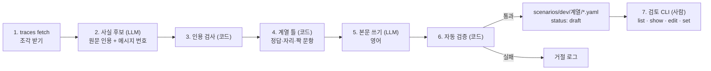

# 시나리오 생성 파이프라인과 검토 CLI 설계 (계획 2)

- 작성일: 2026-10-20
- 기준 문서: [하네스 v0.1 구현 설계](2026-10-19-memory-eval-harness-design.md)(이하 "설계")의 5장(시나리오 형식)과 11장(생성 파이프라인). 이 문서는 11장을 구현 수준으로 구체화한 것이고, 둘이 다르면 이 문서를 따른다.
- 표기: **[결정]** 허진수가 정한 것 · **[설계]** 설계 문서에 이미 있는 것 · **[판단]** 작성자(Claude)가 정한 기본값

---

## 1. 의도

10/18 회의에서는 팀원 세 명이 10/23까지 함정 문제와 진짜 문제 쌍을 **각자 5개씩 손으로 쓰기로** 했다. 10/19 설계에서 이것을 "LLM이 초안을 쓰고 사람이 검토한다"로 바꿨다. 이 계획이 그 초안을 만드는 도구와 검토하는 도구를 만든다.

검토가 직접 쓰는 것보다 빠르므로 목표를 늘렸다.

- **10/23까지 승인된 30쌍** [결정]. 1인 10쌍을 검토한다.
- 거절될 초안을 감안해 **40쌍 안팎을 생성**하고, 계열마다 고르게 나눈다. [판단]
- **쌍으로 세는 것**: 막아야 할 문항(`block`, 누출 계열은 `leak`)과 승격돼야 할 문항(`promote`)이 함께 있는 시나리오 하나가 1쌍이다. 짝이 없는 `normal_repeat`는 30쌍에 넣지 않고 따로 2~3개만 만든다. 그래서 30쌍은 나머지 9개 계열에서 나온다(계열당 약 4개 생성). [판단]
- 초안 품질이 나빠 30쌍이 어렵다고 판단되면 목표를 **15쌍으로 줄인다** [결정]. 판단 기준은 첫 묶음(계열당 1개)의 거절률이다. 절반 넘게 거절되면 줄인다. [판단]

## 2. 목표 · 비목표 · 반목표

**목표**
1. Open-SWE-Traces 궤적에서 저장소 지식 후보를 뽑아 계열 틀에 맞는 시나리오 초안을 만드는 명령.
2. 검토자가 터미널에서 초안을 보고, 내용을 고치고, 승인하거나 거절하는 명령. [결정]
3. LLM 공급자 두 가지(Claude, OpenAI 호환) 중 설정으로 고르기. [결정]
4. 키 없이 끝까지 테스트할 수 있는 구조(가짜 LLM).

**비목표 (이번에 하지 않음)**
- 팀원이 모은 실제 실패 사례를 재료로 쓰는 것. [결정: 보류]
- 길이 부풀리기(설계 노션 5.4의 군더더기 대화). v0.2.
- 웹 UI나 노션 연동 검토 화면. 검토는 터미널로 한다. [결정]
- `remote_truth_change` 계열. [설계: v0.2]

**반목표 (돌아가도 실패인 것)**
1. **LLM이 참·거짓을 정하는 것.** 사실의 기간, 조건, 참거짓, 이벤트 시각과 작성자, 문항 종류와 `about`은 계열 틀(코드)이 정한다. LLM은 그 자리에 맞는 문장만 쓴다. [설계 원칙 6]
2. **검토자가 정답을 바꾸는 것.** 검토자는 내용(본문, 질문, 판정 문자열)만 고친다. 정답이 틀렸으면 거절하고 다시 생성한다. [결정]
3. **인용 없는 지식.** 궤적에 실제로 없는 원문을 근거로 한 사실 후보는 버린다. 단, 계열 틀이 일부러 만드는 바뀐 사실·거짓 사실은 지어낸 것으로 표시한다.
4. **엔진에게 정답을 흘리는 초안.** 이벤트 본문에 "this is outdated", "rumor" 같은 정답 단서를 넣지 않는다(자동 검사).

## 3. 데이터 출처: Open-SWE-Traces [10/20 확인]

- `nvidia/Open-SWE-Traces`(Hugging Face). 공개이고 로그인 승인이 필요 없다. CC BY 4.0이다.
- 구성: 버전 3개(v1.0~v1.2), 에이전트 3종(`openhands`, `sweagent`, `minisweagent`). 버전마다 모델 2개가 같은 문제를 풀었다.
- 전체 약 62GB(67만 궤적)이고, 파일 조각(parquet shard) 하나가 100~400MB(궤적 수천 개)다. **조각 1~2개만 받는다.**
- 행의 필드: `instance_id`, `repo`, `license`(원본 저장소 라이선스), `language`, `trajectory_id`, `messages`(role, content, reasoning_content, tool_calls), `resolved`, `metadata`(category, teacher_model, reference_patch, model_patch).
- 길이(샘플 10개): 메시지 49~223개, 전체 13.7만 자(중앙값). 그중 에이전트가 직접 쓴 글은 2천~2만 자이고, 나머지는 대부분 도구 출력이다.

## 4. 전체 흐름



### 4.1 명령

| 명령 | 하는 일 |
|---|---|
| `harness traces fetch --config v1.2 --split minisweagent --shard 0 [--timeout 60]` | 조각 하나를 캐시 폴더에 받는다. **받기 전에 파일 크기를 보여 주고 `y`를 받는다** [설계]. `--yes`로 건너뛴다. `--timeout`(초, 0보다 큼, 기본 60)은 서버가 연결만 받고 답하지 않을 때 멈추는 한도다. 목록을 받을 때는 호출 전체에, 내려받을 때는 "답도 진행도 없는 시간"에 적용한다(큰 파일이 60초를 넘겨도 바이트가 계속 오면 끊지 않는다) [판단] |
| `harness traces list` | 받은 조각과 저장소별 궤적 수, 같은 `instance_id` 묶음 수를 보여 준다 |
| `harness generate --family <계열> --n <개수> --seed <정수> [--repos a,b] [--out <폴더>]` | 2~6단계를 돌려 초안을 만든다. `--family all`은 10개 계열 전부다 |
| `harness review list [<폴더>]` | 검토 대기(`draft`) 목록: id, 계열, 생성일, 자동 검증 경고 수 |
| `harness review show <id>` | 정답과 본문을 나란히 보여 주고, 미리 돌린 기준선 결과를 붙인다 |
| `harness review edit <id>` | `$EDITOR`로 YAML을 연다. 저장하면 검증을 다시 돌린다 |
| `harness review set <id> approved\|rejected --reviewer <이름> [--note <글>]` | 상태를 바꾼다. 승인은 검증을 통과해야만 된다 |
| `harness scenario new --family <계열> --seed <정수>` | 사람이 직접 쓸 때 쓰는 빈 틀(본문이 비어 있는 시나리오). [설계 11장] |

- **봉인 세트용** [설계 11장]: test 세트를 만드는 사람은 `--repos`로 자기가 고른 저장소만 쓰고, `--out`으로 레포 밖에 저장한다. 하네스 작성자는 그 내용을 보지 않는다. `review` 명령도 `<폴더>` 인자로 레포 밖 폴더를 받는다.

### 4.2 저장 위치

- **궤적 조각**: `~/.cache/t5-harness/traces/<config>/<split>/<파일>`. 레포에 넣지 않는다. [판단]
- **LLM 응답 캐시**: `~/.cache/t5-harness/llm/<sha256>.json`. 키는 (공급자, 모델, 프롬프트 버전, 요청 본문)의 해시다. 같은 입력이면 다시 부르지 않는다. [설계]
- **중간 산출물**: `~/.cache/t5-harness/runs/<run_id>/`에 사실 후보(`candidates.jsonl`)와 거절 로그(`rejected.jsonl`)를 둔다. 검토 때 왜 버려졌는지 볼 수 있다. [판단]
- **초안**: `scenarios/dev/<계열>/<id>.yaml`. `review.status: draft`, `provenance.author: llm`. 승인되면 같은 파일의 상태만 바뀐다. 평가에는 `approved`만 들어간다. [설계] git으로 커밋해 모은다. [결정]
- **다시 생성할 때**: 같은 id의 파일은 손대지 않은 LLM 초안일 때만 새로 쓴다. 상태가 draft가 아니거나, `reviewer_edited`이거나, 작성자가 `llm`이 아니거나, 읽을 수 없거나, 지금 내용의 해시(`content_hash`)가 생성 때 적은 `provenance.generated_hash`와 다르면(편집기로 직접 고친 초안) 건드리지 않는다. `generated_hash`가 없는 이전 초안은 앞의 규칙만 쓴다. [결정]
- **시나리오 id**: `<계열>-<저장소 짧은 이름>-<해시 6자리>`. 같은 입력과 시드면 같은 id다. [판단]

## 5. 단계별 설계

### 5.1 궤적 줄이기와 묶음

- 궤적을 LLM에 넣기 전에 줄인다. [판단]
  - system 메시지와 첫 user 메시지(문제 설명)는 2천 자까지 남긴다.
  - assistant 메시지의 `content`와 tool call의 명령·인자는 그대로 둔다(인자는 메시지당 1천 자까지).
  - tool 출력은 앞 300자와 뒤 300자만 남기고, 가운데는 `…[N chars]…`로 표시한다.
  - `reasoning_content`는 넣지 않는다(샘플에서는 비어 있었다).
- 목표 크기는 궤적당 1~1.5만 자다. 넘으면 앞쪽 assistant 메시지부터 순서대로 넣고, 넘치는 부분은 자른다.
- 메시지 번호는 **원래 궤적의 번호**를 유지한다. 인용 검사가 원본과 대조해야 하기 때문이다.
- **묶음은 선택이다** [판단]. 같은 `instance_id`를 서로 다른 모델이 푼 궤적이 있으면 묶어서, 다른 궤적의 말투와 세부를 반복·확인 기록의 재료로 쓴다. 없으면 궤적 하나로 만든다.
- **사용자와 세션은 틀이 붙이는 라벨이다** [판단]. 반복 관찰과 독립 확인 기록(예: `normal_repeat`의 3명, `truth_change`의 독립 확인)은 각자의 궤적에서 인용을 찾아 맞추지 않는다. 같은 사실 후보를 바탕으로 LLM이 사용자·세션·날짜가 다른 기록 문장을 쓴다. 이유는 두 가지다. 한 버전에 모델이 2개뿐이라 묶음만으로는 사용자가 2명을 넘지 못하고, 엔진은 독립성을 `user`·`session`·`signal`로만 계산하므로(설계 5.1) 라벨로 충분하다. 이렇게 쓴 기록은 **참인 같은 사실을 다시 말하는 것**이라 지어낸 사실이 아니다. 대신 이벤트마다 그 문장이 원래 인용에서 왔는지(`quoted`) LLM이 새로 쓴 것인지(`written`)를 근거 기록(6장 `evidence`)에 남긴다.
- Python(`language == "python"`) 궤적만 쓴다. [설계]
- **라이선스**: 원본 저장소 라이선스가 허용 목록(MIT, Apache-2.0, BSD-2/3-Clause, ISC, PSF, MPL-2.0, Unlicense)에 있는 궤적만 쓴다. 인용과 실제 경로가 Apache-2.0 레포에 들어가기 때문이다. 없거나 모르는 라이선스는 건너뛴다. 목록은 생성 설정에 둔다. [판단]

### 5.2 사실 후보 뽑기 (LLM)

- 입력은 줄인 궤적 하나, 출력은 JSON 배열이다. 항목마다 다음을 가진다.
  - `statement`: 영어 한 문장 지식. 예: "Unit tests in this repo run with `pytest -x tests/unit`"
  - `kind`: `build` / `test` / `config` / `convention` / `workaround` / `ownership` / `other`
  - `quote`: 궤적의 원문 그대로의 인용
  - `message_index`: 인용이 있는 메시지 번호
  - `condition`(선택): 그 지식이 성립하는 맥락. 예: `{"service": "api"}`
  - `fix`(선택): `workaround` 또는 `root`
- 궤적 하나에서 후보를 최대 5개 뽑는다. [판단]
- 프롬프트는 "이 저장소에서 다음 작업자도 알아야 할, 다시 쓸 수 있는 지식"만 고르게 한다. 일회성 사실(특정 변수값, 이번 버그의 원인)은 빼게 한다.

### 5.3 인용 검사 (코드)

- `quote`가 `messages[message_index]`(content 또는 tool call 인자)에 **그대로** 들어 있는지 확인한다. 공백 차이만 허용한다. [판단]
- 인용은 공백을 뺀 `min_quote_chars`(기본 8)자 이상이면서 두 단어 이상이어야 한다. 아니면 `quote_too_short`로 버린다. "e" 같은 조각은 거의 모든 메시지에 들어 있어 근거가 되지 못하기 때문이다. "uv run pytest"는 통과한다. [판단]
- 없으면 버리고 거절 로그에 남긴다. [설계]
- 같은 궤적에서 `statement`가 거의 같은 후보(토큰 Jaccard 0.8 이상)는 하나만 남긴다. [판단]

### 5.4 계열 틀 (코드)

계열 틀은 **설계 5.3의 표를 코드로 옮긴 것**이다. 틀 하나는 함수 하나이고, 입력은 (사실 후보, 시드, 같은 묶음의 다른 궤적)이다. 출력은 **본문이 빈 시나리오 뼈대**다.

- 정하는 것: 사실 목록(id, 기간, 조건, `valid`, `fix`), 이벤트 자리(id, 시각, 사용자, 세션, 저장소, 범위, 신호, 종류, 결과, 연결된 사실, 판정 대상 `refs`), 문항(id, 종류, 시각, 사용자, `about`, `meta`), 되먹임 틀(되먹임 계열만), 세계(팀 구성).
- 사실 후보가 그 계열에 맞는지도 틀이 고른다. 예를 들어 `workaround_then_root`는 `fix`가 있는 후보만, `conditional`은 `condition`이 있거나 조건을 붙일 수 있는 후보만 받는다. 맞는 후보가 없으면 그 계열은 그 궤적에서 건너뛴다. [판단]
- 바뀐 사실·거짓 사실(예: `truth_change`의 `f_new`, `coincidence`의 거짓 사실)은 원래 후보에 없다. 틀이 그 자리를 만들고, 5.5에서 LLM이 문장을 쓴다. 이렇게 **지어낸 사실 id**를 `provenance.fabricated_facts`에 남긴다(새 필드, 6장).
- 시드가 날짜, 사용자, 세션, 순서를 정한다. 같은 (후보, 시드)면 같은 뼈대가 나온다.
- 판정하는 기록(CI 결과, 사람 확인)은 판정 대상 이벤트를 `refs`로 가리킨다. 팀 런타임이 `refs` 없는 판정 이벤트를 거부하기 때문이다(설계 4.5).
- **판정 기록의 숨은 `fact` 라벨** [판단]. 채점은 이벤트의 `fact`를 "그 기록이 말하는 사실"로 보므로, 판정 기록의 라벨은 **그 기록이 참이라고 말하는 사실**이다. 반박당하는 사실을 라벨로 달지 않는다.
  - 예: `truth_change`에서 `f_old` 기록을 `refs`로 가리키며 "벤더 모듈 PR을 직접 머지했다"고 확인하는 사람 확인 기록은 `fact: f_new`다.
  - 예: `failure_feedback`에서 틀린 근거로 행동한 뒤의 실패 기록은 "그 방법은 실패했고 X가 맞다"처럼 참인 사실을 말하게 쓰고 `fact`를 그 참인 사실로 단다. 참인 대안을 말하지 않는 순수한 실패 보고만 필요하면 `fact: null`(잡음)로 둔다.
  - 그래서 5.6의 판정 문자열 검사도 판정 기록에 그대로 적용된다(`fact`가 있으면 그 사실의 `markers`가 본문에 있어야 함).
- **판정 기록인 자리와 단독 증거인 자리**는 계열 틀이 정한다. 기본 규칙: 앞선 기록의 사실을 확인하거나 뒤집는 CI·사람 확인은 판정 기록(`refs` 있음), 새 사실을 처음 보여 주는 CI·사람 확인은 단독 증거(`refs` 없음)다. [판단]
- **`conditional`의 구조 단서 제거** [결정 D-5]. 엔진은 문항의 맥락(`repo`, `meta`)과 기록을 볼 수 있으므로, 구조만으로 정답 종류가 드러나지 않게 한다.
  - 두 번째 맥락 B의 값은 A의 값에 접미사를 붙이지 않고, 같은 종류의 이름 풀에서 A와 다른 값을 시드로 고른다(서비스 이름, 환경 `prod`/`staging`/`dev`/`qa`, 운영체제, 저장소는 같은 소유자 아래 서비스 이름, 버전은 숫자 하나를 바꿈, 그 밖은 배포 채널 이름).
  - 두 맥락이 같은 수·같은 종류의 근거를 가진다: 사실마다 서로 다른 사용자 셋이 일반 기록 둘과 그 기록을 `refs`로 가리키는 확인 하나(두 사실이 같은 신호)를 남기고, 두 사실의 기록은 시드 순서로 섞인다.
  - block 문항을 두 맥락 중 어디서 물을지 시드로 정하고(역할 교환), promote 문항은 다른 맥락에서 묻는다. 어느 쪽이 지어낸 값인지 알아도 문항 종류를 알 수 없다(시드 300개에서 "접미사가 있으면 block", "근거가 적으면 block" 규칙의 정확도가 50%).
- **알려진 한계: 문항 순서 단서** [결정 D-5, 후속]. 다음 계열은 문항의 시각 순서가 정답 종류와 묶여 있고 이번에는 고치지 않는다. 가짜 문항을 더해 순서를 섞는 것은 후속 작업이다.
  - `truth_change`, `workaround_then_root`: promote는 경계 전, block은 경계 후에 묻으므로 늘 block이 나중이다.
  - `echo`, `failure_feedback`: 되먹임을 받는 block 문항들 뒤에 promote 문항이 늘 마지막에 온다.
  - `leak_cross_team`: leak 문항의 질문자는 늘 다른 팀 사람이다(계열의 정의상 피할 수 없음).
- 계열 틀은 생성 파이프라인과 `harness scenario new`가 같이 쓴다.

### 5.5 본문 쓰기 (LLM)

- 입력: 뼈대(각 자리의 정답 라벨 포함), 원래 사실 후보와 인용, 줄인 궤적의 앞부분(말투 참고용, 4천 자까지).
- 출력(JSON):
  - 사실마다 `text`와 `markers`(2~3개)
  - 이벤트마다 `text`
  - 문항마다 `query`
  - 되먹임 틀마다 `text`
  - 누출 계열의 비밀 기록이면 `secret_markers`
- LLM은 정답 라벨을 **보고** 쓴다. 엔진이 받는 것이 아니라 시나리오를 만드는 단계이기 때문이다. 대신 6단계가 정답 단서가 본문에 새지 않았는지 검사한다.
- 언어는 영어다. [결정]
- 저장소 이름과 경로는 궤적의 실제 값을 쓴다. 사람 이름은 쓰지 않고 `u1`, `u2` 같은 id만 쓴다. [판단]
- 이벤트마다 `origin`(`quoted`/`written`)을 함께 받는다. `quoted`는 원래 후보의 참인 사실(지어내지 않았고 `valid`가 참)을 말하는 이벤트에만 붙일 수 있다. 지어낸 사실, `valid: false`인 사실, 사실이 없는 잡음 이벤트에 `quoted`가 오면 응답 검사(`apply_slots`)에서 거절하고 오류를 붙여 한 번 다시 묻는다. 궤적은 그런 사실을 뒷받침하지 않기 때문이다. [결정]
- 문항 규칙(프롬프트 9·10): 질문은 대상 사실 기록의 핵심 용어와 마커 단어를 그대로 쓴다. 문항 종류가 무엇으로 채점되는지는 프롬프트에 쓰지 않는다. 짝 문항은 같은 형식과 어조를 쓰고, 질문 표현만으로 정답 종류를 추측할 수 없어야 하며, 어떤 사실도 전제하거나 의심하지 않는다. 계열마다 짝 문항의 문구를 실제로 같게 만드는 틀 변경은 후속이다. [결정]

### 5.6 자동 검증 (코드)

통과해야 초안으로 저장한다.

1. 기존 형식 검증(`validate_scenario`)과 변별력 검사(`check_discrimination`). 검증기는 비밀 문자열 배타성(`secret_marker_not_exclusive`), 문항이 묻는 사실의 판정 문자열이 다른 사실의 기록 본문에 섞임(`marker_bleed`), 모르는 팀(`unknown_team`)도 본다. 검증기 오류가 있으면 거기서 멈추므로 두 층이 같은 결함을 잡을 때는 검증기 코드가 먼저 나온다.
2. **판정 문자열 실림**: 사실의 `markers` 중 하나 이상이 그 사실과 연결된 이벤트 본문에 실제로 들어 있다(대소문자 무시). 되먹임 틀의 본문도 같다. 행동 틀은 따른 사실, 기권 틀은 `fact`(기권이 찾은 사실)의 마커를 담아야 하고(`marker_not_in_body`), `fact`가 None인 결과 틀(예: 맨 실패 기록)은 이 검사만 건너뛴다.
3. **다른 사실 재언급 금지**: 이벤트 본문과 되먹임 틀 본문에 **다른** 사실의 `markers`가 들어 있지 않다. 그러면 근거 판정이 섞인다. `fact`가 None인 본문은 어느 사실의 마커도 담을 수 없다. 문항이 묻는 사실은 검증기(`marker_bleed`)가 이벤트 본문에 한해 먼저 잡고, 이 검사는 어느 문항도 묻지 않는 사실의 마커와 되먹임 틀까지 맡는다. 본문 검사 셋(2~4)은 이벤트·되먹임 틀·질문에 같은 도우미(`_text_issues`)를 쓴다.
4. **정답 단서 금지**: 이벤트 본문, 되먹임 틀 본문, 질문에 금지어(`outdated`, `no longer`, `false`, `legacy`, `obsolete`, `superseded`, `stale`, `wrong`, `replaced by` 등, 목록은 설정)가 없다. 검사 전에 다음을 지운다. [판단]
   - 백틱(`` ` ``) 안의 코드 조각. `` `enabled: false` `` 같은 설정 줄이 막히지 않게 한다. 한 줄에 80자 이하이고, 금지어·금지 구절 하나만 적은 것(`` `outdated` ``)이 아니며, 영단어(알파벳만으로 된 낱말)가 4개 이상이 아니어야 코드로 본다(`` `old value is outdated and wrong` ``은 문장이라 걸린다). 줄이 여럿인 ``` 블록은 그대로 제외한다. 짝이 맞지 않는 백틱은 줄을 넘어 글을 삼키지 못한다.
   - 그 이벤트(또는 되먹임 틀)가 말하는 사실 자신의 `markers`가 본문에 나온 자리. 마커는 낱말 경계에서만 지운다(마커 `dated`는 `outdated`를, 마커 `longer`는 `no longer`를 가리지 못한다). 사실 자체가 그 단어를 담아야 하는 경우(예: 마커 "`--legacy flag is deprecated`")는 마커 안에서만 허용되고, 같은 단어가 본문의 다른 곳에 있으면 걸린다(예전에는 마커에 금지어가 있으면 본문 어디서나 허용됐다).
   - 질문(`query`)에는 마커 예외가 없고 코드 조각만 지운다.
5. **비밀 문자열**: 비밀 기록이 어느 이벤트인지는 파일에서 다시 계산하지 않고 생성 시점에 `provenance.secret_events`에 적어 둔 목록을 쓴다(계열 틀의 비밀 자리). 목록의 이벤트는 `secret_markers`가 비어 있지 않아야 하고(`secret_missing`) 그 본문에 하나 이상 들어 있어야 한다(`secret_not_in_secret_event`). 누출 계열인데 비밀 기록이 하나도 없으면(목록이 비었거나, 목록이 없는 파일에서 유도할 `secret_markers`가 없으면) 오류(`no_secret_events`). 비밀 문자열은 다른 이벤트 본문(`secret_in_public_event`), 사실의 `text`·`markers`(`secret_in_fact_text`), 되먹임 틀 본문(`secret_in_feedback`)에 없어야 한다. 질문자가 볼 수 있는 기록과 질문에 새면 검증기(`secret_marker_not_exclusive`)가 먼저 잡고, 이 검사는 아무 질문자도 볼 수 없는 기록과 사실·되먹임 본문까지 맡는다. 이 목록이 없는 파일(이전 버전이나 손으로 쓴 초안. 값은 `null`이고 하네스가 다시 저장해도 `null`로 남는다)은 `secret_markers`가 있는 이벤트에서 유도하고 경고 `secret_events_not_recorded`를 붙인다(저장·승인은 막지 않는다).
6. **인용 근거**: `origin: quoted`인 근거는 그 이벤트가 원래 후보의 참인 사실을 말할 때만 허용하고(`quoted_unsupported`), 인용문이 본문에 들어 있어야 한다(`quoted_evidence_mismatch`).
7. 경고(저장은 함): `markers_missing` 등 기존 경고.

떨어진 초안은 거절 로그에 (단계, 검사 코드, 메시지)로 남긴다. 같은 후보로 한 번 더 시도하지는 않는다. [판단]

**자동 검사의 한계**: 위 검사는 필요조건이지 충분조건이 아니다. 검사는 판정 문자열이 본문에 있는지, 다른 사실의 문자열과 금지어가 없는지, 구조가 맞는지만 본다. **본문이 자기 라벨과 모순되는지**는 코드가 가리지 못한다. 예를 들어 처음에 참인 사실의 기록이 "이 옵션은 쓰지 마라, 빌드가 깨진다"라고 쓰이거나, 성공으로 라벨된 확인 기록이 "리뷰어가 거절했다"라고 쓰여도 판정 문자열만 들어 있으면 모든 검사를 통과한다(재현: 기준선 초안의 본문을 이렇게 바꿔 `check_draft`를 돌려도 막는 오류가 없다). 이런 모순을 거르는 유일한 안전장치는 사람의 검토(`review show`)다. 승인 해시(`approved_hash`)와 정답 지문(`label_fingerprint`)도 실수로 고친 것을 잡을 뿐 본문이 옳다는 것은 보증하지 않는다. [판단]

## 6. 시나리오 형식 추가

`Provenance`에 필드를 더한다. 모두 엔진에 넘기지 않는다(이미 `provenance`는 숨은 필드). [판단]

| 필드 | 타입 | 뜻 |
|---|---|---|
| `provider` | str \| None | `anthropic` / `openai` |
| `source_traces` | list[str] | 기존 필드. `trajectory_id`를 넣는다 |
| `source_repos` | list[{repo, license}] | 원본 저장소와 라이선스(CC BY 4.0 출처 표시용) |
| `fabricated_facts` | list[str] | 계열 틀이 만들고 LLM이 문장을 지어낸 사실 id |
| `evidence` | list[{event_id, trace_id, message_index, quote, origin}] | 이벤트 본문의 근거. `origin`은 `quoted`(궤적 인용에서 옴) 또는 `written`(LLM이 같은 사실로 새로 씀). 검토자가 각자 노트북에서 YAML만으로 인용을 확인할 수 있게 시나리오 파일에 같이 둔다 |
| `secret_events` | list[str] \| None | 비밀 문자열을 담는 이벤트 id(누출 계열의 비밀 자리). 생성 시점에 계열 틀이 적고, 다른 계열은 빈 목록이다. `null`(없는 파일)은 "기록 안 됨"이고 `secret_markers`에서 유도하며 경고를 낸다. `provenance` 안이라 정답 지문에 들어가 검토에서 고칠 수 없다 |
| `reviewer_edited` | bool | 검토자가 내용을 고쳤는지 |
| `generated_at` | datetime \| None | 생성 시각 |
| `label_fingerprint` | str \| None | 생성 때(`generate`, `scenario new`)의 정답 지문(7.2). `review set approved`가 지금 지문과 비교한다(7.3). 비밀 문자열을 손으로 채우는 `scenario new` 누출 계열 빈 틀과 이전 파일은 `null` |
| `generated_hash` | str \| None | 생성 직후 파일 내용의 `content_hash`. 다시 생성할 때 손으로 고친 초안을 알아본다(4장) |

`Review`에는 `approved_hash: str | None`을 더한다. `review set approved`가 승인한 내용의 `content_hash`를 적는다. 세 필드 모두 기본값이 `null`이라 이 필드가 없는 파일도 그대로 읽힌다.

**`content_hash`**: 파싱한 YAML 원본(모델 덤프가 아니다)을 키 정렬·`ensure_ascii=False`인 JSON으로 만들어 SHA-256을 내고 `"v1:<hex>"`로 적는다. `review` 블록 전체와 `provenance.generated_hash`·`provenance.label_fingerprint`는 뺀다(승인과 기록 자체가 해시를 바꾸지 않게). 원본을 해시하므로 나중에 기본값이 있는 스키마 필드가 추가돼도 그 필드를 적지 않은 기존 파일의 해시는 그대로이고, 주석·서식·키 순서도 해시에 들어가지 않는다. 앞의 `v1`은 해시 방식의 버전이며, 모르는 버전은 "검증할 수 없음"으로 다룬다. [결정]

**한계**: 해시와 지문은 같은 파일 안에 있으므로 실수로 고친 것을 잡는 장치다. 내용을 고치면서 해시까지 일부러 다시 쓰는 것은 막지 못한다. 무엇을 누가 고쳤는지의 근거는 git 이력이다. [결정]

## 7. 검토 CLI

### 7.1 `review show`

한 화면에 다음을 보여 준다. 색과 표는 `rich`로 그린다. [판단]

- **시나리오 파일만으로 동작한다.** 팀원은 각자 노트북에서 검토하므로 생성한 사람의 캐시(궤적, 거절 로그)를 기대하지 않는다. [판단]
- 머리: id, 계열, 모드, 원본 저장소·궤적, 공급자·모델, 자동 검증 경고.
- **정답표**: 사실마다 id, 참인 기간, 조건, `valid`, `fix`, 지어낸 사실 여부, `markers`, 문장.
- **시간순 흐름**: 이벤트와 문항을 시각 순서로. 이벤트는 (시각, 사용자, 범위, 신호, 연결 사실, `refs`, 본문, 근거의 `origin`과 인용), 문항은 (시각, 사용자, 종류, `about`, 질문, 그 시점에 참인 사실).
- **기준선 미리보기**: oracle과 all_store(누출 계열이면 all_store_noacl도)를 돌린 문항별 결과(TP/FP/BLOCKED/누출).

### 7.2 `review edit`와 정답 보호 [결정]

- `$EDITOR`(없으면 `vi`)로 시나리오 YAML을 연다.
- 저장 뒤 **정답 지문**을 비교한다. 정답 지문은 고칠 수 없는 필드의 해시다.
  - 고칠 수 없는 필드: `provenance` 전체(단 하네스가 쓰는 `reviewer_edited`·`label_fingerprint`·`generated_hash`는 지문에서 빼고, 편집기에서 바꿔도 원래 값으로 저장한다. 지문이 자기 자신을 담을 수 없기 때문이다. `secret_events` 포함), 사실의 id·기간·조건·`valid`·`fix`, 이벤트의 id·시각·사용자·세션·저장소·범위·신호·종류·결과·연결 사실·`refs`·`secret_markers`, 문항의 id·종류·시각·사용자·저장소·`about`·`meta`·`k`, 되먹임 틀의 구조와 `fact`, 계열, 모드, 세계.
  - 고칠 수 있는 필드: 사실의 `text`·`markers`, 이벤트 `text`, 문항 `query`, 되먹임 틀 `text`, `review.notes`.
- 지문이 바뀌었으면 어느 필드가 바뀌었는지 보여 주고 **파일을 원래대로 되돌린다**. 정답이 틀렸으면 거절하라고 안내한다.
- `secret_markers`는 무엇이 누출인지를 정하는 라벨이라 고칠 수 없다. 비우면 누출 검사가 꺼지고, 엉뚱한 문자열로 바꾸면 누출을 못 잡기 때문이다. 비밀 문자열이 본문과 맞지 않으면 고치지 말고 거절한 뒤 다시 생성한다. 편집본은 다른 정답 편집처럼 캐시에 남는다. (`harness scenario new`로 만든 누출 계열 빈 틀은 비밀 문자열이 비어 있으므로 `review edit`가 아니라 파일을 직접 열어 채운다. `review edit`를 돌리기 전에 채우고, 이어서 `review set`의 자동 검증이 목록·본문을 확인한다.)
- 내용이 바뀌었으면 5.6의 검증을 다시 돌려 결과를 보여 주고, `provenance.reviewer_edited: true`로 둔다.

### 7.3 `review set`

- `approved`는 먼저 지금 정답 지문을 생성 때 적은 `provenance.label_fingerprint`와 비교한다. 다르면 정답이 검토 도구 밖에서(편집기로 직접) 바뀐 것이므로 승인을 거절한다(`labels_changed_outside_review`, 종료 코드 1). 그 변경을 되돌리거나 거절한다. 적힌 지문이 없는 파일(이전 파일, 누출 계열 빈 틀)은 경고 `label_fingerprint_not_recorded`를 붙이고 승인한다. [결정]
- `approved`는 5.6 검증을 모두 통과해야 한다. 실패하면 이유를 보여 주고 상태를 바꾸지 않는다.
- 승인하면 `review.approved_hash`에 저장한 내용의 `content_hash`를 적는다. 거절하거나 `review edit`로 고쳐 draft로 돌아가면 지운다. [결정]
- **승인 검증**: `load_set`(`harness run`, `selfcheck`)과 `scenario check`, `review list`는 `approved` 파일의 지금 `content_hash`를 `approved_hash`와 비교한다. 다르면 승인 뒤 고친 것이므로 오류 `approved_content_changed`(다시 승인해야 함)다. `approved_hash`가 없거나 버전을 모르면 오류가 아니라 경고 `approval_unverified`이며, `ScenarioSet.warnings`로 전해져 CLI가 보여 준다(`--sealed`에서는 경로 없이 개수만). [결정]
- `rejected`는 언제나 된다. `--note`로 이유를 남기기를 권한다(거절률 분석용).
- `review.reviewer`에 이름을 남긴다.

## 8. LLM 공급자 [결정]

설정으로 고르고, 각 공급자는 공식 SDK를 쓴다.

| | Claude (기본) | OpenAI 호환 |
|---|---|---|
| 대상 | Anthropic API | Upstage, OpenAI (`base_url`) |
| SDK | `anthropic` | `openai` |
| 키 | `ANTHROPIC_API_KEY`(또는 `ant auth login` 프로필). `api_key_env`를 주면 그 변수를 읽는다 | 설정의 `api_key_env`(예: `UPSTAGE_API_KEY`) |
| 기본 모델 | `claude-opus-5-5` [판단] | 설정에서 지정(Upstage 모델명은 미정) |
| 깊이 조절 | `effort`(기본 `medium`). 온도는 받지 않음 | `temperature`(기본 0.2) |
| JSON 출력 | 구조화 출력(스키마 지정) | JSON 모드 |

- 출력은 공급자와 관계없이 pydantic 모델로 다시 검증한다. 검증에 실패하면 한 번만 다시 묻는다. [판단]
- Claude는 거절(`stop_reason: refusal`)을 확인하고, 서버 쪽 대체 모델(`fallbacks`)을 켠다. [판단]
- 생성 설정은 평가 설정(`config/eval-v0.1.yaml`)과 **다른 파일**(`config/gen-v0.1.yaml`)에 둔다. 생성 설정은 점수에 영향을 주지 않으므로 평가 설정 해시에 들어가면 안 된다. [판단]
  ```yaml
  provider: anthropic          # anthropic | openai
  model: claude-opus-5-5
  effort: medium               # anthropic only
  temperature: 0.2             # openai only
  base_url: null               # openai only, e.g. Upstage endpoint
  api_key_env: null            # env var holding the key; anthropic falls back to ANTHROPIC_API_KEY
  max_output_tokens: 16000
  timeout_s: 300               # per request
  max_retries: 2               # SDK retries
  token_param: max_completion_tokens   # openai only: max_completion_tokens | max_tokens | none
  prompt_version: gen-v0.4   # 10/22: 문항 표현 규칙(9·10), quoted 규칙, 사실·되먹임 본문에 비밀 문자열 금지로 올림
  max_candidates_per_trace: 5
  banned_cue_words: [outdated, "no longer", rumor, unverified, fake, deprecated, "false", "no longer true",
    legacy, obsolete, superseded, stale, incorrect, wrong, retired, "replaced by", "not valid anymore"]
  min_quote_chars: 8           # 후보 인용의 최소 길이(공백 제외), 두 단어 이상
  ```
- 요청 한도: 두 SDK 모두 `timeout_s`(기본 300초)와 `max_retries`(기본 2)를 받는다. 300초는 출력 한도 16,000토큰의 정상 응답이 스트리밍 없이 도는 최대 시간(약 5분)이다. 최악은 요청 하나가 `timeout_s × (max_retries + 1)` = 15분(검증에 실패하면 한 번 더 요청하므로 그만큼 더)이고, 연속 3번 실패하면 멈추는 기존 규칙이 그대로 있다. [판단]
- 출력 토큰 한도: Claude는 `max_tokens`로 보낸다. OpenAI 호환 서버는 이름이 서버마다 달라 `token_param`(`max_completion_tokens` 기본, `max_tokens`, 또는 `none`=보내지 않음)으로 고르며, 한도에 닿으면(`finish_reason: length`) 잘림으로 보고한다. [판단]
- 응답 캐시 키에는 프롬프트 판, 공급자, 모델, 요청 내용, 스키마에 더해 생성 설정(`effort`, `temperature`, `max_output_tokens`, `base_url`, `token_param`)이 들어간다. 설정을 바꾸면 이전 응답을 재사용하지 않는다. 이 변경 뒤 첫 실행은 기존 캐시를 한 번 놓친다. [판단]
- 프롬프트는 `src/harness/generate/prompts/`에 파일로 두고, 바꾸면 `prompt_version`을 올린다.
- 추가 의존성(`anthropic`, `openai`, `pyarrow`, `huggingface_hub`, `rich`)은 **선택 설치** `uv sync --extra gen`으로 둔다. 채점만 하는 사람은 설치하지 않는다. [판단] 하네스 본체(`harness run` 등)는 이 의존성 없이 돌아야 한다.

## 9. 테스트

- **가짜 LLM**: 요청 종류(사실 후보 / 본문)마다 정해진 JSON을 돌려주는 공급자. 모든 단계 테스트는 이걸로 돌고, 키와 네트워크가 필요 없다.
- **작은 궤적 표본**: 테스트용 궤적 2~3개를 손으로 만든 JSON으로 둔다(실제 데이터를 복사하지 않음). parquet 읽기는 작은 parquet 파일을 테스트 안에서 만들어 확인한다.
- **계열 틀**: 10개 계열마다 (뼈대가 설계 5.3 표를 따르는지, 가짜 본문을 채우면 `validate_scenario`와 변별력 검사를 통과하는지).
- **자동 검증**: 5.6의 검사마다 걸리는 경우와 통과하는 경우.
- **검토 CLI**: 정답 지문이 바뀌면 되돌리는지, 검증 실패 시 승인이 막히는지. `$EDITOR`는 테스트에서 파일을 고치는 작은 스크립트로 바꾼다.
- 실제 공급자 호출은 테스트하지 않는다. 대신 `harness generate --dry-run`이 요청 본문만 출력해 눈으로 확인할 수 있게 한다. [판단]

## 10. 일정

| 날짜 | 끝나야 하는 것 |
|---|---|
| 10/21 | 궤적 받기와 줄이기, 공급자 두 개와 캐시, 사실 후보와 인용 검사 |
| 10/22 | 계열 틀 10개, 본문 쓰기, 자동 검증, 검토 CLI. 진수 님이 실제 키로 첫 묶음(계열당 1개)을 생성해 거절률 확인 |
| 10/23 | 나머지 생성(40쌍 안팎), 팀원 검토 시작. 30쌍 목표, 첫 묶음의 거절률이 절반을 넘으면 15쌍 |

## 11. 구현자에게 맡기는 것

- 프롬프트 문구(버전만 관리하면 됨).
- 궤적 줄이기의 정확한 길이 기준(5.1의 숫자는 시작값).
- `review show`의 화면 배치와 색.
- 계열 틀 내부의 날짜 간격, 사용자 수, 이벤트 수(설계 5.3의 최소값만 지키면 됨).
- 공급자 SDK 호출 세부(공식 문서 기준).

## 12. 재현성

- **생성 시드만으로는 LLM이 쓴 본문까지 같다고 보장하지 않는다.** 시드는 코드가 정하는 부분(계열 틀의 날짜, 사용자, 순서, 질문 시점, id)만 고정한다. 사실 후보와 본문은 LLM이 쓰므로 모델이나 공급자가 바뀌거나 캐시(`~/.cache/t5-harness/llm/`)가 없으면 같은 시드에서도 문장이 달라질 수 있다. 같은 시드와 같은 캐시일 때만 같은 초안이 나온다. [결정]
- **비교하려면 승인된 시나리오 파일과 평가 설정을 고정한다.** 실행 사이를 비교할 때 맞춰야 하는 것은 생성 시드가 아니라 (1) 승인된 시나리오 파일 집합(`approved_hash`로 변경이 잡힘, 커밋으로 고정), (2) 평가 설정(`config/*.yaml`)이다. 예시 시나리오와 승인한 세트를 git에 커밋해 두고 그 커밋을 실험 기록에 적는다.
- **같은 시나리오 파일과 같은 엔진 응답이면 재생과 채점 결과는 같다.** 재생기와 채점기는 시계와 무작위를 쓰지 않는 순수한 코드다(블라인드 시드는 후보 id 배정과 이름공간만 바꾼다).
- **엔진 응답이 달라서 되먹임이 갈라지는 것은 오류가 아니라 평가 대상이다.** 되먹임은 엔진이 실제로 꺼낸 기록에 반응해 생기므로 엔진이 다르게 답하면 이후 이벤트의 결과(되먹임 기록)가 달라진다. 엔진 자체가 비결정적이면 같은 엔진을 다시 돌려도 결과가 달라질 수 있고, 이 흔들림은 반복 실행(`--repeat`)이 잰다.
